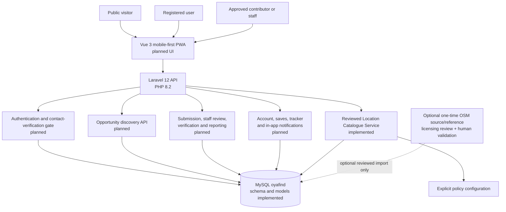
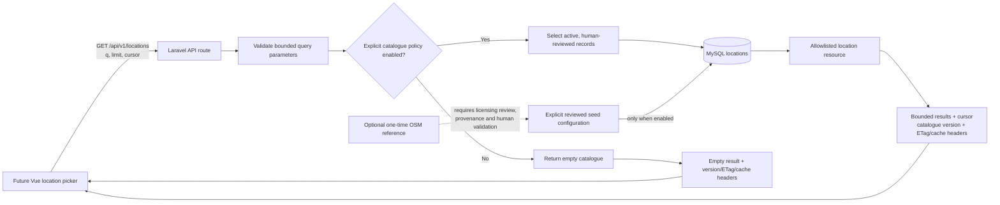
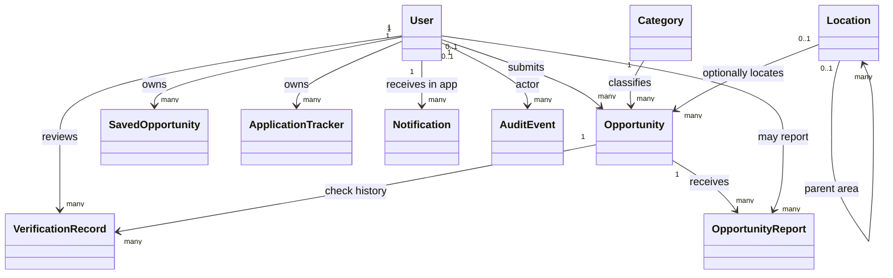
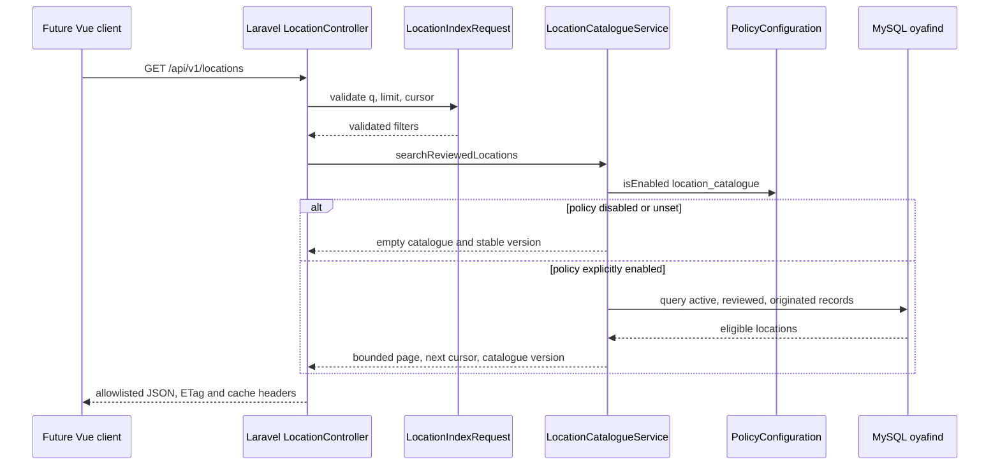
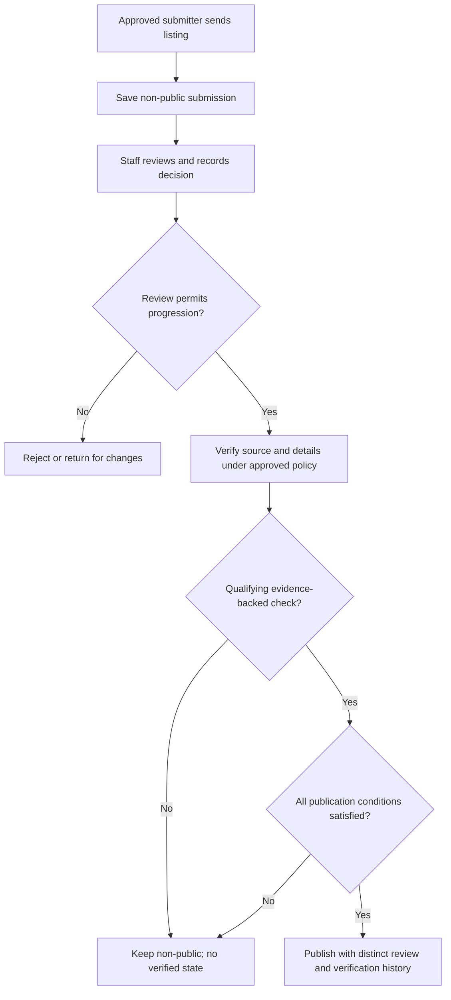

# OyaFind MVP Design Document

## Overview

OyaFind is a public opportunity-discovery service for the 30-day Ibadan, Oyo State pilot. It is intended to help people find and assess jobs, gigs, internships, scholarships, training, grants, business support and tenders. Public discovery is available without an account; accounts are for private saves and a user-maintained application tracker. The product must not imply that OyaFind submits applications, guarantees a provider or outcome, or confirms a user's reported application status.

**Confirmed stack:** Laravel 12 on PHP 8.2, Vue 3, and MySQL database `oyafind`. The mobile-first installable PWA remains the product-form assumption. These choices describe the intended stack, not a deployment or a confirmed live database connection.

**Trust and publication rule:** Every listing requires staff review. Publication additionally requires that the source and listing details have been verified under an approved verification policy. Staff approval alone is insufficient. A verified state must never be inferred, synthesized, or assigned because information is missing. The verification checklist, evidence standard, authorized reviewer policy, and verification recheck mechanism are unresolved; until approved, the system must not publish a listing as verified.

**Implementation status (snapshot: 2026-10-22):** Tasks 1–3 are done; no later implementation task is complete. The Laravel/Vue scaffold, schema, migrations and models are implemented. `GET /api/v1/locations` exists and is policy-gated: it returns an empty catalogue until explicitly configured, and returns only active, human-reviewed records when enabled. Its search and cursor pagination are bounded; responses include catalogue version/ETag and cache headers, and use a public allowlisted resource. The location seeder accepts only explicitly configured reviewed records; the default seed configuration is empty. Tests use synthetic fixtures only: there is no real geography and no live MySQL database. Direct full PHPUnit for Task 3 passed 33 tests / 122 assertions; Pint passed; the application build passed earlier. No MySQL connection or migration has been performed. Opportunity API/UI, the location-picker UI, and account features are not implemented. This status does not mean the MVP is complete or deployed.

### Confirmed requirements and boundaries

- Authentication is email **or** phone plus password. The selected contact must pass verification before the account becomes active or save access is enabled. Whether a pending account record is created before verification, and the verification provider and flow, remain unresolved.
- Contributors and employers require staff approval before submission access.
- Every listing is reviewed by staff, and only listings with verified source and details may be published. Verification must not be synthesized. Checklist, evidence handling, reviewer authorization and verification recheck remain unresolved.
- A listing without a deadline is rechecked every 30 days from publication or its last completed recheck. When overdue, it is hidden from public access and treated as expired until rechecked.
- Notifications are in-app only. Push notifications are excluded.
- Tracker status values are exactly `interested`, `preparing`, `applied`, `interview`, `successful`, `unsuccessful`, and `user-reported`. They represent user-maintained reports, not employer-confirmed outcomes.
- Privacy, retention, account deletion, and reporting policy details remain open.
- OpenStreetMap (OSM) may be used optionally as a one-time source/reference only after licensing review. Applicable licensing and attribution obligations must be met, provenance retained, and a human must validate labels and area hierarchy before any record becomes selectable. OSM is not a runtime location service or an approved source dataset by default.

## Architecture

### System Architecture Diagram

The diagram distinguishes planned MVP components from the one implemented API surface. Dashed boxes and edges indicate optional or not-yet-implemented capabilities.



### Data Flow Diagram

The location endpoint is the only feature API in the current implementation status. The picker client in this flow is a future consumer; no picker UI is implemented.



The implemented route validates `q` (up to 100 characters), `limit` (default 20, maximum 100), and a positive `cursor`; unrecognized query parameters are prohibited. The service orders by ID, filters active records with review time, reviewer and non-empty origin, and returns a bounded page. The resource exposes only the location's `id`, `name`, `slug`, `location_type` and a similarly allowlisted parent summary. When policy is unset/disabled it returns an empty catalogue. When enabled, it supplies a catalogue version, ETag, `X-Catalogue-Version`, and cache headers. These implementation details do not establish that any real selectable area exists.

## Components and Interfaces

The interfaces below describe the intended design. Only the location catalogue API and its supporting backend are implemented; all other feature interfaces are proposed and must not be mistaken for existing routes or UI.

### 1. Vue 3 experience

- **Responsibilities:** Future public opportunity browsing, search, detail, sharing, location selection, registration/sign-in, saves, tracker, reporting, submission and staff views; responsive, accessible status and error states.
- **Interfaces:** Planned public and account routes; calls the versioned Laravel API. The location picker is not implemented.
- **Dependencies:** Vue 3 scaffold, API client, and any explicitly approved app-shell/offline behavior.
- **Status:** Vue scaffold exists; opportunity and account screens/features are not implemented.

### 2. Laravel API and policy boundary

- **Responsibilities:** Validate requests, authenticate the principal for protected operations, enforce resource ownership and staff capabilities, return public/private response projections, and fail closed when an owner-approved feature policy is absent.
- **Implemented interface:** `GET /api/v1/locations`, routed through `LocationController`, `LocationIndexRequest`, `LocationCatalogueService`, `LocationResource`, and `PolicyConfiguration`.
- **Planned interfaces:** Opportunity discovery, account, moderation, report, tracker and notification APIs; none is implemented.
- **Dependencies:** Laravel 12, PHP 8.2, explicit configuration and MySQL `oyafind`.

### 3. Reviewed location catalogue

- **Responsibilities:** Serve only active records with recorded human review and origin; provide bounded text search and cursor pagination; return a version and HTTP validators/cache headers; keep internal reviewer and source-provenance fields out of public output.
- **Implemented interface:** `GET /api/v1/locations?q=&limit=&cursor=`. Catalogue enablement requires explicit configuration. `LocationSeeder` seeds only configured records after the policy is enabled and validates review metadata; the configured seed list is empty by default.
- **Dependencies:** Location schema/models, configuration policy, and future human-approved records.
- **Status and limitation:** Synthetic API tests exercise the behavior. No real area list, human-approved Ibadan geography, live database or location-picker UI is present. The API's response pagination is bounded; its catalogue version is calculated from the selectable public projection.

### 4. Authentication and account

- **Responsibilities:** Register/sign in with email or phone plus password; require verification of the chosen contact before the account is saved/activated for protected use; assign least privilege; prohibit self-assigned roles; authorize all protected actions server-side.
- **Planned logical interfaces:** `register`, `verifyContact`, `signIn`, `signOut`, `getOwnProfile`, `updateOwnProfile`.
- **Open decisions:** Verification provider and delivery/verification flow; precise boundary between a pending account record and an activated account; session implementation and account lifecycle policy.
- **Status:** Account features are not implemented.

### 5. Opportunity discovery and listing trust

- **Responsibilities:** Planned public discovery must expose only staff-reviewed, source/detail-verified, published and non-expired listings. Submission must not publish automatically. Publication and verification are separate state dimensions. A verified claim requires an actual qualifying human check; no default or inferred verified state is allowed.
- **Planned logical interfaces:** `listPublicOpportunities`, `getPublicOpportunity`, `createSubmission`, `updateSubmission`, `listReviewQueue`, `reviewListing`, `recordVerification`, `changePublicationState`.
- **Open decisions:** Verification checklist, acceptable and retained evidence, reviewer authorization, recheck mechanism, material-edit policy, permitted state transitions and user-facing verification wording.
- **Status:** Opportunity API, user interface, and moderation workflows are not implemented.

### 6. Reports, private workspace and notifications

- **Responsibilities:** Planned report intake and staff disposition; owner-only saves and tracker; in-app notifications delivered only to their intended recipient. Tracker statuses are user-reported. No push channel is in scope.
- **Planned logical interfaces:** `createReport`, `resolveReport`, `saveOpportunity`, `removeSavedOpportunity`, `upsertOwnApplication`, `listOwnNotifications`, `markOwnNotificationRead`.
- **Open decisions:** Report categories, abuse controls, response expectations, privacy and retention, deletion, support access, notification events and retention.
- **Status:** Account features, reports and notification delivery are not implemented.

### 7. Listing freshness and expiry

- **Responsibilities:** Planned lifecycle behavior for deadline expiry and no-deadline rechecks. A no-deadline listing becomes hidden and expired when its 30-day recheck interval is overdue, and may be made public again only after the required review/recheck succeeds.
- **Planned logical interface:** `findListingsDueForRecheck`, `recordRecheck`, `hideOverdueListings`, `expireByDeadline`.
- **Open decisions:** Deadline timezone and boundary semantics, operational assignment, and the relationship between listing freshness and verification-policy rechecks. The fixed 30-day no-deadline rule does not resolve the separate verification recheck mechanism.
- **Status:** Lifecycle jobs and user-facing expiry features are not implemented.

## Data Models

The schema, migrations and Eloquent models exist for the core domain, but this is not proof of a live database migration or functioning end-user features. The database currently uses several nullable/open string columns where product policy is unresolved. The definitions below express the design contract; they do not approve undocumented enum values or imply that routes/workflows are implemented.

### Core Data Structure Definitions

```typescript
type ID = number;
type ISODateTime = string;

type TrackerStatus =
  | "interested"
  | "preparing"
  | "applied"
  | "interview"
  | "successful"
  | "unsuccessful"
  | "user-reported";

interface User {
  id: ID;
  name: string;
  email?: string | null;
  phone?: string | null;
  passwordHash: string; // Never serialized.
  role?: string | null; // Server-managed; allowed values/policy are not finalized.
  status?: string | null; // Server-managed; no assumed default.
  emailVerifiedAt?: ISODateTime | null;
  phoneVerifiedAt?: ISODateTime | null;
  homeLocationId?: ID | null;
  interests?: unknown;
  createdAt: ISODateTime;
  updatedAt: ISODateTime;
}

interface Location {
  id: ID;
  name: string;
  slug: string;
  parentId?: ID | null;
  locationType?: string | null;
  isActive: boolean;
  reviewedAt?: ISODateTime | null;
  reviewedBy?: ID | null;
  catalogueOrigin?: string | null;
  sourceName?: string | null;
  sourceReference?: string | null;
  sourceVersion?: string | null;
  sourceRetrievedAt?: string | null;
}

interface PublicLocation {
  id: ID;
  name: string;
  slug: string;
  location_type: string | null;
  parent: Pick<PublicLocation, "id" | "name" | "slug" | "location_type"> | null;
}

interface Category {
  id: ID;
  name: string;
  slug: string;
  description?: string | null;
  iconKey?: string | null;
  isActive: boolean;
  sortOrder: number;
}

interface Opportunity {
  id: ID;
  title: string;
  slug: string;
  summary: string;
  description: string;
  categoryId: ID;
  locationId?: ID | null;
  submittedBy: ID;
  organisationName: string;
  sourceUrl?: string | null;
  applicationUrl?: string | null;
  applicationMethod?: string | null;
  eligibility?: string | null;
  deadlineAt?: ISODateTime | null;
  publicationStatus?: string | null; // Exact lifecycle policy is unresolved.
  verificationStatus?: string | null; // Never synthesized; values require policy.
  publishedAt?: ISODateTime | null;
  verifiedAt?: ISODateTime | null;
  verifiedBy?: ID | null;
}

interface SavedOpportunity {
  userId: ID;
  opportunityId: ID;
  createdAt: ISODateTime;
}

interface VerificationRecord {
  id: ID;
  opportunityId: ID;
  reviewerId: ID;
  result: string;
  checkType: string;
  evidenceUrl?: string | null;
  evidenceSummary?: string | null;
  evidenceRationale?: string | null;
  restrictedNotes?: string | null;
  checkedAt: ISODateTime;
}

interface ApplicationTracker {
  id: ID;
  userId: ID;
  opportunityId: ID;
  status: TrackerStatus;
  statusSource: "user-reported";
  notes?: string | null; // Private to the user, subject to approved retention policy.
  appliedAt?: ISODateTime | null;
  createdAt: ISODateTime;
  updatedAt: ISODateTime;
}

interface OpportunityReport {
  id: ID;
  opportunityId: ID;
  reporterId?: ID | null;
  reason?: string | null;
  details?: string | null;
  status?: string | null;
  resolvedBy?: ID | null;
  resolutionNote?: string | null; // Restricted; retention/access policy unresolved.
  createdAt: ISODateTime;
  resolvedAt?: ISODateTime | null;
}

interface AuditEvent {
  id: ID;
  actorId?: ID | null;
  action: string;
  entityType: string;
  entityId?: ID | null;
  metadata?: Record<string, unknown> | null; // Minimize and restrict access.
  createdAt: ISODateTime;
}

interface Notification {
  id: ID;
  userId: ID;
  type: string;
  data?: Record<string, unknown> | null;
  readAt?: ISODateTime | null;
  createdAt: ISODateTime;
  // In-app only. No push endpoint or subscription.
}
```

### Data Model Diagrams



**Persistence and privacy constraints:** Preserve foreign-key integrity and review/audit history. Keep public DTOs allowlisted. Password hashes, verification evidence, internal notes, report identities, private tracker notes and staff-only dispositions must not appear in public responses. User-owned records must be queried and mutated using the authenticated principal, not a client-supplied owner ID. Apply exact retention, account deletion, and support-access rules only after the privacy policy is approved.

The implemented verification-record model is append-only and requires either an evidence URL or a documented evidence rationale. This is a structural guard only; it does not define or approve the unresolved verification checklist, evidence standard, reviewer authorization, or publication workflow.

## Business Process

### Process 1: Location catalogue request (implemented API; picker UI not implemented)

1. A future client calls `GET /api/v1/locations` with optional bounded `q`, `limit`, and `cursor`.
2. `LocationIndexRequest` validates the query parameters and rejects unknown filters.
3. `LocationCatalogueService` checks the explicit `location_catalogue` policy. If disabled or unset, it returns an empty catalogue. If enabled, it selects active records with review time, reviewer, and origin; search and page size are bounded.
4. `LocationResource` returns only allowlisted location and parent fields. The response carries the catalogue version, ETag, `X-Catalogue-Version`, and cache policy.
5. The seeder creates records only from explicit configured reviewed records and only when the catalogue policy is enabled. No location records are configured by default.



### Process 2: Listing submission, review and publication (planned)

1. An approved contributor/employer submits a listing; the server must save it as non-public.
2. Staff reviews the submission and records the decision, reviewer and time.
3. Source and listing details are checked under the verification policy. Evidence and reviewer permissions must follow the policy once defined.
4. The listing may publish only when both staff review and source/detail verification requirements are satisfied. A review decision cannot manufacture a verification result.
5. Material edits and verification rechecks follow approved policies. All public listing reads exclude unpublished or overdue listings.



### Process 3: Account activation and private tracking (planned)

1. A visitor may browse public listings without registration.
2. Registration accepts email **or** phone plus password. The selected contact must pass verification before the account becomes active or save access is enabled. Whether a pending account record is created before verification, and the verification provider and flow, remain undecided.
3. Contributor/employer submission privileges are granted only after staff approval; public registration cannot grant these roles.
4. An eligible user may save a listing and update their own tracker. The tracker accepts exactly the seven `TrackerStatus` values defined above and records them as user-reported.
5. Tracker reads and writes are owner-scoped. OyaFind does not infer that an external application was submitted or that an outcome was confirmed.

### Process 4: Freshness, expiry and notification (planned)

1. Listings with a deadline are expired according to a deadline policy whose timezone/boundary details remain open.
2. For a listing without a deadline, schedule a staff recheck every 30 days from publication or the latest completed recheck.
3. If the no-deadline recheck is overdue, hide the listing from public access and treat it as expired until rechecked.
4. Any generated notification is delivered only through the in-app channel to its intended user. Do not create push subscriptions, send push notifications, or describe them as part of the MVP.
5. Record lifecycle actions for audit where the approved privacy/retention policy permits; exact retention is unresolved.

### Process 5: Optional OSM reference use

OSM/Geofabrik may be considered only as an optional one-time input/reference, not a live service. Before use, complete a documented ODbL licensing review and identify applicable attribution/share-alike obligations. Retain source reference, retrieval date and dataset version/snapshot for imported rows. A human must validate each proposed selectable label and hierarchy. Without these gates, do not import or expose OSM-derived geography as selectable; do not invent an area list.

## Error Handling

| Condition | Required behavior |
|---|---|
| Location policy missing or disabled | Return a successful empty catalogue and safe cache metadata; do not fall back to unreviewed or external data. |
| Invalid or unknown location query parameter | Return a validation error; do not silently broaden the query. |
| No location matches | Return an empty bounded result; location remains optional for discovery. |
| Location API unavailable | A future UI may use a previously cached reviewed catalogue only with a clear stale indication; without cache, show a recoverable error and preserve all-location browsing. Offline picker behavior is not implemented. |
| Missing, incomplete, or outdated listing verification | Do not publish or present the listing as verified. Keep it unavailable until an approved check meets policy. |
| No-deadline listing passes 30-day recheck interval | Hide it from public access and treat it as expired until rechecked. |
| Authentication, verification, or authorization failure | Deny protected operation server-side; avoid leaking account/listing existence or staff-only details. |
| MySQL connection or migration failure | Do not claim a successful live database operation. Current validation has not used a live MySQL database. |
| Offline or failed write for future user features | Do not show saves, reports, tracker edits, or submissions as persisted without server confirmation. |
| Privacy/retention rule is unresolved | Do not invent a retention period, expose private data, or assume staff access. Escalate the policy decision before relying on that behavior. |

## Testing Strategy

### Existing evidence

- Tasks 1–3 are the only completed implementation tasks.
- Task 3 direct full PHPUnit: **33 tests, 122 assertions**. Test fixtures are synthetic; they do not validate real Ibadan geography.
- Pint passed.
- The application build passed earlier; this is not a claim that a current build was rerun for this document update.
- No real geography or live MySQL database was used; no MySQL connection or migration has been performed.
- Existing location API tests cover the disabled/empty policy, active and human-reviewed filtering, bounded search/cursor behavior, invalid query rejection, public field allowlisting, ETag/catalogue version changes, conditional requests, and reviewed configured seeding.

### Design-level validation boundaries

For implemented location behavior, automated tests should continue to use synthetic controlled records and assert policy-off emptiness, reviewer/origin gating, bounds, stable cursor ordering, validators and public-field allowlists. Any future real geography must be human-approved separately and must not be inferred from synthetic tests.

For unimplemented product features, the intended test design must cover:

- Contact verification gating and least-privilege account assignment once provider and flow are decided.
- Server-side authorization and ownership boundaries for accounts, submissions, saves, tracker, reports and staff operations.
- Independent staff-review and source/detail-verification gates; no synthetic verified status; audit history for state changes.
- Exact seven tracker statuses, privately scoped to the owning user and clearly marked user-reported.
- 30-day no-deadline recheck, overdue hiding/expiry, deadline behavior once timezone rules are approved, and no push notification path.
- Privacy-safe serialization, reporting access, account deletion and retention after those policies are approved.
- Conditional OSM provenance, licensing and attribution behavior only if a one-time import is approved; human validation before selectability.

These are design validation expectations, not evidence that the corresponding APIs, UI, jobs, or tests exist today.

### Technical references

- [Laravel 12 documentation](https://laravel.com/docs/12.x/) — framework reference for the confirmed backend stack; does not imply feature completion.
- [Vue Guide](https://vuejs.org/guide/) — reference for the confirmed client framework.
- [OWASP API Security Top 10:2023, API1](https://owasp.org/API-Security/editions/2023/en/0xa1-broken-object-level-authorization/) and [API3](https://owasp.org/API-Security/editions/2023/en/0xa3-broken-object-property-level-authorization/) — rationale for server-side object authorization and allowlisted output.
- [W3C WCAG 2.2](https://www.w3.org/TR/WCAG22/) — accessibility target for future user-facing workflows; no conformance claim is made.
- [OpenStreetMap copyright and license](https://www.openstreetmap.org/copyright) — source licensing and attribution reference for any optional one-time use; no import is approved or asserted as completed.

## Unresolved Decisions

These remain explicit decision gates and must not be silently selected by implementation:

1. **Account verification:** provider, delivery mechanism, verification steps and exact account activation/save gate.
2. **Contributor/employer approval:** operational approver and process details, while the requirement for prior staff approval is fixed.
3. **Listing trust:** checklist, evidence standard/storage/access/retention, reviewer authorization, verification recheck, material-edit rules, allowed state transitions and public verification wording. The requirements that every listing receives staff review and only verified source/details publish are fixed.
4. **Expiry:** deadline timezone/boundary and operational job behavior. The no-deadline 30-day recheck and overdue hiding/expiry requirement are fixed.
5. **Privacy and retention:** privacy/legal notice, data minimization, analytics consent, account deletion, retention periods for personal data/reports/tracker/evidence/audit records, and permitted support access.
6. **Reporting:** exact report categories, anonymous-report abuse controls, response/triage expectations and whether contact details are ever requested.
7. **Location data:** Ibadan taxonomy, accountable human reviewer/maintainer, and any OSM/Geofabrik one-time source use. Any such source use requires documented licensing review, attribution, provenance retention and human area validation.
8. **Remaining product and operations details:** PWA/offline cache scope, notification events/retention (in-app-only is fixed; push is excluded), API conventions, analytics policy and pilot success thresholds.

This document intentionally does not resolve these decisions or assert completion of unimplemented features.
