# OyaFind MVP Implementation Tasks

This plan reflects the latest approved PRD and design. The confirmed stack is Laravel 12 on PHP 8.2, Vue 3, and MySQL database `oyafind`; the mobile-first installable PWA remains the product-form assumption. Hosting/deployment remains open. Tasks 1–7 are complete; Task 3 includes the implemented location API described below, and Task 7 leaves contact registration blocked until its provider, delivery flow and pending-account policy are approved. These are coding and automated-acceptance-test tasks only: no task authorizes a live database migration, geography download/import, manual app run, deployment, user testing, performance measurement, or documentation authoring.

## External owner decisions — gates, not coding tasks

These approvals are not tasks in this plan. A code task may implement only the behavior and values approved by the relevant owner. An unresolved decision gates only its dependent feature or configuration; it does not block unrelated public discovery. In particular, geography approval gates real selectable catalogue data and location-specific fixtures/configuration, not discovery without a location filter or tests using clearly synthetic controlled fixtures.

- **Account:** verification provider, delivery mechanism and flow; account-pending/activation details. The selected email OR phone contact must be verified before saving; do not enable an unconfigured delivery/verification path.
- **Contributor access:** which individual contributors/employers are approved and operational approval details. Submission access must be granted only by staff.
- **Trust and publication:** source/detail verification checklist, acceptable evidence, authorized verifier criteria, verification recheck mechanism, and approved public copy. Fixed rule: every listing receives staff review and source/details must be verified before publication; neither condition can be inferred or synthesized.
- **Expiry and freshness:** deadline timezone/boundary, reminder/event policy and retention/archive behavior. Fixed rule: listings without deadlines are rechecked every 30 days and hidden/expired when overdue.
- **Reports:** reasons, triage/response target, anonymous-report abuse controls, and whether contact details are ever requested.
- **Privacy and legal:** privacy/legal notice, analytics consent, personal-data/account/evidence/audit/report/tracker retention and deletion, and permitted support access.
- **Notifications:** approved in-app notification events and retention. In-app is the only channel; push notifications are out of scope.
- **Data and product policy:** whether an organization entity is needed; numeric launch thresholds and day-30 decision owner; currency, compensation visibility and salary-range conventions. The tracker status set is fixed: `interested`, `preparing`, `applied`, `interview`, `successful`, `unsuccessful`, `user-reported`.
- **Other product/API choices:** whether non-paid editorial featuring exists and its criteria/label; API identifier/response/error conventions, supported sort/search behavior, page-size bounds, rate/abuse thresholds and retry mapping.
- **Geography:** exact Ibadan coarse-area taxonomy and accountable human validator/maintainer. Optional one-time OSM/Geofabrik use is user-authorized subject to actual licensing review before use and human validation before any location is selectable; legal review and exact area names/approver remain gates. No ongoing data feed is planned. Geofabrik Nigeria data is raw source data, not a validated Ibadan area list. Imported rows require provenance/source reference, retrieval date and dataset version/snapshot, with applicable ODbL attribution/license disclosure.
- **Technology/environment:** hosting/deployment details. Laravel 12, PHP 8.2, Vue 3, MySQL and database name `oyafind` are confirmed, not approval gates.
- **Test profiles/budgets:** representative Android browser/device profiles and any numeric performance/transfer budget.

## Implementation checklist

- [x] 1. Establish the Laravel/Vue application and automated-test foundation
  - Configure the Laravel 12 / PHP 8.2 application, Vue 3 entry point and automated test harness; configure MySQL database name `oyafind` in database settings and non-secret environment examples. These confirmed versions do not imply a deployed environment or live MySQL connection; hosting remains open.
  - Add and test a validated policy/configuration boundary for unresolved owner-approved values. Dependent features must fail closed without fabricated defaults; public discovery must remain runnable without geography policy values.
  - Add automated tests for configuration validation, safe missing-policy behavior, and the configured database name. Do not put credentials in source or test configuration.
  - _Requirements: PRD §5.2; §5.3 decisions 1–10; Requirements 3 AC 1–8, 6 AC 1–9, 8 AC 4–5; §7.3 NFR 3–4; §7.4 NFR 4–5; §14 readiness conditions 1 and 7; Design Architecture, Authentication and account, Error Handling._

- [x] 2. Implement core Laravel models, migrations, constraints and confirmed category seeds
  - Add `app/Models/{User,Location,Category,Opportunity,SavedOpportunity,ApplicationTracker,OpportunityReport,VerificationRecord,Notification,AuditEvent}.php` as applicable, corresponding `database/migrations/*` migrations and `database/seeders/CategorySeeder.php`. Include foreign keys, unique constraints, indexes, UTC timestamps and deliberate deletion behavior from the design.
  - Create only the eight confirmed category seed records. Add location review fields (`reviewed_at`, reviewer reference and selectable `is_active` state) plus provenance fields (`source_name`/origin, `source_reference`, `source_version` or dataset snapshot, `source_retrieved_at`) without importing or seeding real areas. Preserve optional location on opportunities and profiles. Do not model Ibadan as one LGA, invent taxonomy, or add sponsored-listing fields.
  - Keep schema behavior that depends on unresolved contact-verification delivery, organization, compensation, notification-event and privacy/retention decisions configurable/conditional; do not encode proposed values as approved defaults. The tracker status set is confirmed and exact: `interested`, `preparing`, `applied`, `interview`, `successful`, `unsuccessful`, `user-reported`.
  - Write migration/model/seed tests for constraints, category coverage, optional location, human-review fields, imported-row provenance requirements and the absence of unapproved geography.
  - _Requirements: PRD §§5.2–5.3, 8.1–8.12, especially 8.2 and 8.12; Requirements 3 AC 1 and 7, 4 AC 2–3, 5 AC 1–6, 6 AC 1–9, 7 AC 5, 8 AC 3 and 6; Design Data Models and Persistence and integrity constraints._
  - _Open gates: exact area names/hierarchy and human approver; actual legal/licensing review before any optional OSM/Geofabrik source use, and human validation before selectability. Optional one-time source use is authorized in principle, not a default data import._

- [x] 3. Build the reviewed-area catalogue service, gated seed and Laravel API contract
  - Completed implementation: `GET /api/v1/locations` is routed through `LocationController`, `LocationIndexRequest`, `LocationCatalogueService`, `LocationResource` and `PolicyConfiguration`. It validates bounded `q`, `limit` and positive `cursor`, rejects unknown query parameters, returns only active records with human-review metadata and origin, and uses bounded cursor pagination.
  - The catalogue returns an allowlisted public resource, catalogue version, ETag, `X-Catalogue-Version` and cache headers. Explicit policy keeps the catalogue empty unless enabled; `LocationSeeder` accepts only explicitly configured reviewed records and the default seed configuration is empty. No public write route or real selectable area data is present.
  - Use synthetic controlled records only in service/API tests. Keep real area rows unavailable until exact names/hierarchy and a human validator are approved; optional OSM/Geofabrik source use is authorized in principle but actual use is gated on licensing review, provenance obligations and human validation. Do not fetch/convert raw data or add a runtime external-locator dependency.
  - Preserve imported-row provenance and, if OSM-derived choices are eventually displayed, implement and test the applicable ODbL attribution/license disclosure. Do not imply that licensing review or human validation has already occurred.
  - Add service/API tests for bounded search, hierarchy, reviewed/active filtering, invalid direct filters, version/validator changes, public-field allowlists, and no results when no approved selectable areas exist.
  - _Requirements: PRD §5.3 decision 8, §5.4, Requirement 1 AC 2 and 9–11, Requirement 8 AC 6, §7.1 NFR 7–8, §§8.2, 9.1, 9.5; Design Reviewed location catalogue, Process 1 and 5, Error Handling, Testing Strategy._
  - _Open gates: exact location names/hierarchy and human approver; actual legal/licensing review before optional OSM/Geofabrik source use; human validation before real records are selectable. Synthetic tests and unfiltered discovery are not gated._

- [x] 4. Implement public discovery queries, resources and API endpoints
  - Add `app/Services/DiscoveryService.php`, repository/query code, public API resources and feed/detail/category handlers for `GET /api/v1/opportunities`, `GET /api/v1/opportunities/{slug}` and `GET /api/v1/categories`.
  - Public feed and detail queries must return only current, published, staff-reviewed listings whose source and details are verified under the approved policy. Require distinct attributable staff-review and qualifying verification records; never derive/fake `verified` from publication, missing fields, client input, or staff approval alone. Fail closed when policy or qualifying evidence is absent; synthetic domain fixtures may exercise the guard but must not fabricate public verified state.
  - Support allowlisted text search, category, optional reviewed location, work mode, supported sort and bounded pagination. An unfiltered request must work without location data or location-policy configuration and return all otherwise eligible matches. Reject invalid filters rather than silently broadening them; omit an optional featured endpoint unless a non-paid editorial policy is approved.
  - Add automated domain/API tests for filter behavior, unfiltered browsing with an empty location catalogue, synthetic location-filter fixtures, empty results, pagination, stable slugs, exclusion of non-public/expired/archived/overdue listings, staff-review and evidence-backed verification gates, inability to fake verified state, safe response fields and consistent validation/error envelopes.
  - _Requirements: Requirement 1 AC 1–8; Requirement 2 AC 1–2 and 8; Requirement 6 AC 3–4 and 7; Requirement 7 AC 1–4; PRD §§8.3–8.4, 9.1 and 9.5; §7.1 NFR 1 and 7; Design Opportunity discovery and listing trust, Process 2 and Error Handling._
  - _Dependencies: Tasks 2 and 3. Real-location filter fixtures/configuration remain gated as specified in Task 3; they do not gate unfiltered discovery._

- [x] 5. Implement Vue public discovery and listing-detail experience
  - Add Vue components/routes for the feed, search/results, category browsing, opportunity detail, share actions and report entry point (for example `resources/js/pages/DiscoveryPage.vue`, `SearchPage.vue`, `OpportunityDetailPage.vue`, and `resources/js/components/OpportunityCard.vue`). Connect them to the API client and preserve supported search/filter state in reloadable/shareable URLs.
  - Render listing source, eligibility, application method, deadline and distinct publication/verification states when available. Provide useful loading, empty, error, expired/unavailable and no-location-filter states. Use safe external application links and make clear that OyaFind does not submit applications or guarantee outcomes.
  - Add Vue component and browser-automation tests for anonymous public browsing, URL state, public projection rendering, stable sharing, safe external navigation and unavailable listings. Use controlled listing fixtures with no assertion that synthetic area names are real or validated.
  - _Requirements: Requirement 1 AC 1–8; Requirement 2 AC 1–2; Requirement 7 AC 6; PRD §§3.1–3.3, 7.1 NFR 1–2, §§10.1–10.2 and 10.5; Design PWA Experience and Workflow 1._
  - _Dependency: Task 4._

- [x] 6. Implement the coarse-area picker, explicit offline cache and locator-exclusion tests
  - Add Vue location-picker/client modules (for example `resources/js/components/LocationPicker.vue`, `resources/js/api/locationCatalogue.ts` and the service-worker/cache policy module) that query only OyaFind’s catalogue API. Cache only the reviewed public catalogue plus version/freshness metadata; revalidate with its version/validator, invalidate superseded versions, show cached/stale state, and permit offline selection only from a previously loaded cache.
  - When the catalogue cannot be fetched and there is no cached copy, show a recoverable picker error and retain all-location browsing. Never substitute unreviewed records. Location remains optional; no private or write action may be queued offline.
  - Implement the app-shell fallback and cache policy for explicitly selected public content as well as the reviewed catalogue. Add automated client/service-worker and browser network-request tests asserting that picker open/search and offline paths do not invoke GPS/browser geolocation, address collection, geocoding, public Nominatim/autocomplete, third-party locator APIs, map tiles or other external location services. Assert cache allowlisting and that auth, profile, saved, tracker, report, notification and staff responses are never cached.
  - Add the conditional OpenStreetMap attribution/ODbL notice in the picker when displayed choices are derived from OSM data; test that it appears when applicable and is absent for OyaFind-authored records.
  - Use synthetic controlled catalogue fixtures for behavior tests. Real selectable-area seeds remain gated by exact human-approved names/hierarchy and human validation; optional OSM/Geofabrik use requires actual licensing review before source use. Attribution is conditional on displaying derived choices.
  - _Requirements: Requirement 1 AC 2 and 9–11; Requirements 7 AC 3 and 6; PRD §3.2, §3.3, §5.4, §7.1 NFR 3–5 and 7–8, §9.1, §10.5; Design Vue API Client and Service Worker, Workflow 6, Error Handling and Testing Strategy._
  - _Dependencies: Tasks 3 and 5. Real geography is not a prerequisite for unfiltered discovery or synthetic-fixture tests._

- [x] 7. Implement account authentication and private profile boundaries
  - Add Laravel authentication/session services, request validation and `/api/v1/auth/*` and `/api/v1/me` handlers, plus Vue registration, sign-in, sign-out and profile screens (`resources/js/pages/{Register,Login,Profile}Page.vue`). Assign the least-privileged role server-side; allow only approved profile fields and optional coarse home-area/interests preferences.
  - Accept email OR phone plus password and assign the least-privileged role server-side. Implement a contact-verification policy interface and fail-closed verified-contact guard, but do not select or activate a provider, delivery mechanism, verification flow or pending-account boundary until approved. Do not permit saves for an unverified selected contact, and never claim an unconfigured delivery path is available.
  - Protect sessions and profile updates; avoid account enumeration in errors. Add automated tests for identifier validation, login/logout/session invalidation, suspended-account denial, safe errors, profile ownership/allowlists, role/status/verification mass-assignment rejection, verified/unverified contact-gate behavior using synthetic fixtures, and optional location preferences. Use no real geography-dependent profile fixture.
  - _Requirements: Requirement 3 AC 1–8; Requirement 4 AC 1–3; PRD §5.3 decision 1, §§8.1, 9.2, 9.5, 10.1 and 10.3; §7.3 NFR 1–4; Design Authentication and account._
  - _Open gate: contact verification provider, delivery policy and flow. Domain guards and synthetic tests can proceed; live contact delivery/verification activation cannot._

- [ ] 8. Implement owner-scoped saves and private application tracker
  - Add Laravel save/tracker services and `/api/v1/me/saved-opportunities` and `/api/v1/me/applications` handlers, plus Vue saved-list and tracker screens (`resources/js/pages/SavedPage.vue`, `MyOpportunitiesPage.vue`). Derive ownership from the authenticated principal, enforce unique/idempotent upserts and present tracker status as user-reported.
  - Require the Task 7 verified-selected-contact guard before every save create/update; derive ownership from the authenticated principal, enforce unique/idempotent upserts, and permit saves only for currently public eligible listings. For associated non-public listings, return an appropriate unavailable state without restricted listing details.
  - Implement the confirmed tracker status allowlist exactly: `interested`, `preparing`, `applied`, `interview`, `successful`, `unsuccessful`, `user-reported`. Mark all statuses as user-reported; do not make them configurable or imply employer confirmation. Keep tracker records owner-scoped.
  - Add automated tests for own-record CRUD, verified versus unverified contact save gating, duplicate saves, idempotency, forbidden cross-user access, forged owner IDs, exact status allowlist, private notes, safe unavailable-listing rendering and unauthenticated return flow. Do not encode unresolved retention/deletion or support-access policy.
  - _Requirements: Requirements 3 AC 7–8, 4 AC 1–7 and 5 AC 1–6; PRD §5.3 decision 5, §§8.5–8.6, 9.3, 10.1 and 10.3; §7.3 NFR 1–2 and 7; Design Authentication and account, Reports, private workspace and notifications._
  - _Dependencies: Tasks 2, 4 and 7. Contact verification provider/flow gates delivery activation, not the domain guard or synthetic tests; privacy, retention/deletion and authorized support access remain gates for their dependent behavior._

- [ ] 9. Implement submission, moderation, verification and staff interfaces
  - Add Laravel submission/review/verification services and protected API routes, Vue contributor/staff pages and forms, and attributable audit writes. Submission must remain draft/pending review and non-public; enforce server-side capabilities, allowed transitions, ownership, field validation and safe text/URL rendering.
  - Require staff approval for contributor/employer submission access. Every submitted listing stays non-public until it has both an attributable staff review and successful source/detail verification meeting the approved policy. Keep review and verification as separate domain records/guards; never create a verified state from submission, staff approval, client input or incomplete evidence.
  - Proceed with submission/review domain components, policy guard interfaces, protected interfaces and synthetic fixtures/tests. Keep the exact verification checklist, evidence standard/handling, authorized verifier policy, verification recheck mechanism, material-edit rules and public wording fail-closed/unavailable until approved; do not enable publication or verified claims without the required approved policy. Contributor approval remains staff-controlled and non-self-assignable.
  - Add tests for non-public submission, field-specific validation, staff approval and least privilege, authorization/ownership, staff-review gate, absent/incomplete verification-policy gate, qualifying evidence guard using controlled fixtures, audit attribution, evidence/internal-field privacy, and distinct publication/verification UI states. Do not create a featured/paid listing path.
  - _Requirements: Requirements 2 AC 1–2 and 6–8, 6 AC 1–9, 8 AC 1 and 3–4; PRD §§5.1(5), 5.3 decisions 2–3 and 5, §§8.4, 8.8, 8.11–8.12, 9.4–9.5, 10.1 and 10.4–10.5, §§11.1–11.3; §7.3 NFR 1–5 and 7; Design Opportunity discovery and listing trust, Process 2._
  - _Dependencies: Tasks 2 and 4. Verification checklist/evidence/reviewer authorization/recheck and privacy/retention gate verified/publication behavior, not domain components or synthetic guard tests. Contributor eligibility details and organization-model choice remain open._

- [ ] 10. Implement public reporting, abuse controls and staff dispositions
  - Add Laravel `ReportService`, anonymous/authenticated `POST /api/v1/reports`, protected staff report queue/disposition routes and Vue report form/queue views. Restrict report reasons/details to approved configured values, apply approved abuse controls, return non-disclosing acknowledgements and audit staff dispositions.
  - Keep reporter identity, narrative, resolution notes and contact information out of public resources, routine logs and analytics. Do not invent reason taxonomy, response targets, abuse thresholds, contact requests, report retention or takedown policy.
  - Add automated API/UI tests for anonymous and signed-in reports, validation, configured reason handling, rate/abuse behavior, non-disclosure, staff-only access, disposition/audit attribution and sensitive-data redaction.
  - _Requirements: Requirement 2 AC 3–7; Requirement 8 AC 3–4; PRD §5.3 decisions 6–7, §§8.7 and 8.11, §§9.1 and 9.4–9.5, §§10.1 and 10.4–10.5, §11.3; §7.3 NFR 1, 5–7; Design Report Service and Workflow 3._
  - _Dependencies: Tasks 2 and 9. External gates: report reasons/response/abuse policy and privacy/retention/legal decisions._

- [ ] 11. Implement policy-controlled expiry, freshness and notifications
  - Add Laravel scheduled lifecycle job/service and authorized manual expiry/archive/restore handlers. Implement the fixed no-deadline rule: recheck every 30 days from publication or the last completed recheck; when overdue, hide from all public reads and mark expired until rechecked. Make behavior clock-controlled, idempotent, transaction-safe and auditable. Deadline expiry remains policy-configurable until its timezone/boundary is approved; do not block no-deadline handling on that decision.
  - Generate/deliver notifications only in-app and only for explicitly configured/approved events; do not implement push subscriptions, push endpoints or push delivery. Keep unresolved event/retention choices behind policy configuration and fail closed when absent. Enforce notification recipient isolation.
  - Add clock-controlled tests for 30-day recheck timing, overdue hiding/expiry and reactivation guard, deadline behavior only under approved boundary configuration, manual transitions, stale verification guard, retries, duplicate prevention, failed-job/lag signals, recipient isolation, in-app-only behavior and absence of push paths.
  - _Requirements: Requirements 2 AC 8, 7 AC 1–6 and 8 AC 5; PRD §5.1(4), §5.3 decisions 3 and 5, §§8.4, 8.9–8.10, 9.2 and 9.4, §§11.1–11.3; §7.1 NFR 3–5; §7.4 NFR 2 and 5; Design Listing freshness and expiry, Process 4 and Error Handling._
  - _Dependencies: Tasks 2, 4 and 9. Deadline timezone and notification events/retention remain gates for those behaviors; the fixed 30-day no-deadline rule and in-app-only/no-push channel are not unresolved._

- [ ] 12. Implement privacy-conscious pilot analytics, audit and operational signals
  - Add allowlisted event recording, aggregate pilot-summary API and staff view, append-only audit protections and redacted operational/health signals for scheduled-job failures. Include only approved event definitions and consent behavior; aggregate counts for listing supply, discovery, reports and returning use without tracker notes or unnecessary personal data.
  - Keep analytics consent/legal notice, retention, access, event definitions and numeric launch thresholds configurable and unset until approved. Do not create thresholds, perform performance measurement, configure hosting/deployment, or claim backup/restore execution.
  - Add automated tests for aggregation, role access, consent/configuration gating, no private tracker/report/evidence data in metrics, audit attribution/immutability, redacted logs and job-failure signaling.
  - _Requirements: Requirement 8 AC 2–5; PRD §5.3 decisions 7 and 10, §§7.3 NFR 7–9, 7.4 NFR 3–5, 8.11, 9.4–9.5, §§12.1–12.3, 13–14; Design Lifecycle, Notifications and Operations, Workflow 5 and Error Handling._
  - _Dependencies: Tasks 2, 9, 10 and 11. External gates: privacy/legal/consent/retention, numeric launch thresholds, hosting and operations policy._

- [ ] 13. Wire end-to-end workflows and automated accessibility, privacy and network regression tests
  - Register and connect completed Laravel routes/services/jobs, Vue routes/components/API modules, policy configuration and service-worker rules. Add automated end-to-end tests for anonymous discovery through external application navigation, optional location filtering and all-location fallback, verified-contact save gating, owner-scoped tracker, report-to-disposition, submission-to-review/verification guard, 30-day no-deadline expiry/hiding, in-app notifications and stale/offline behavior.
  - Add automated accessibility/security/resilience coverage for semantic labels, validation-error association, keyboard/focus where automatable, text status not color alone, narrow viewport layout, public/private serializer boundaries, ownership/role enforcement, safe inputs, rate limits, offline write confirmation and cache exclusions. Use approved Android profiles only when configured; do not run the app manually or conduct user/device testing.
  - Include network-interception regression assertions that no workflow requests GPS, address/geocoding services, public Nominatim/autocomplete, third-party locator APIs or map tiles; assert there is no push request/subscription path. Use deterministic synthetic location fixtures and keep real-area seeds gated on human approval and any actual source use gated on licensing review.
  - Ensure no service, screen, route, job or cache policy is orphaned. Write and run automated acceptance tests through the configured test command; do not perform live database migrations, manual app runs, deployment, performance measurement, or assert unresolved policy values.
  - _Requirements: Requirements 1 AC 1–11, 2 AC 1–8, 3 AC 1–8, 4 AC 1–7, 5 AC 1–6, 6 AC 1–9, 7 AC 1–6, 8 AC 1–6; PRD §§7.1–7.4, 9.1–9.5, 10.1–10.5, 11.1–11.3, 12.1–12.3 and 14; Design Processes 1–5, Error Handling and Testing Strategy._
  - _Dependencies: Tasks 1–12. Exact location names/approver gate real selectable-area data only; optional OSM/Geofabrik use requires actual licensing review; synthetic tests and unfiltered discovery are not gated._

## Tasks Dependency Diagram

```mermaid
flowchart TD
    G_HOSTING[Open gate: hosting and deployment choices]
    G_ACCOUNT[Open gate: contact verification provider, delivery and flow]
    G_CONTRIBUTOR[Open gate: approved-submitter eligibility details]
    G_VERIFICATION[Open gate: verification checklist, evidence, reviewer authority and recheck]
    G_EXPIRY[Open gate: deadline timezone/boundary and archive details]
    G_REPORTS[External gate: report reasons, abuse controls, response and retention]
    G_PRIVACY[External gate: legal/privacy, consent, deletion and data retention]
    G_NOTIFICATIONS[Open gate: in-app notification events and retention]
    G_ORGANIZATION[External gate: organization data model]
    G_LAUNCH[External gate: launch thresholds and day-30 decision owner]
    G_COMPENSATION[External gate: currency and compensation conventions]
    G_GEO[Open gate: exact Ibadan areas and human approver]
    G_OSM[Legal gate before optional OSM/Geofabrik source use]
    G_PROFILES[External gate: Android profiles and performance budget]

    T1[Task 1: Laravel/Vue foundation]
    T2[Task 2: Models, migrations and category seeds]
    T3[Task 3: Reviewed-area catalogue API]
    T4[Task 4: Public discovery API]
    T5[Task 5: Vue public discovery]
    T6[Task 6: Picker, cache and locator-exclusion tests]
    T7[Task 7: Authentication and profile]
    T8[Task 8: Saves and tracker]
    T9[Task 9: Submission, moderation and verification]
    T10[Task 10: Reporting and dispositions]
    T11[Task 11: Expiry and notifications]
    T12[Task 12: Analytics, audit and operations]
    T13[Task 13: Integration and automated regression tests]

    T1 --> T2
    T1 --> T3
    T1 --> T4
    T2 --> T3
    T2 --> T4
    T3 --> T4
    T3 --> T6
    T4 --> T5
    T5 --> T6
    T2 --> T7
    T1 --> T7
    T7 --> T8
    T2 --> T8
    T4 --> T9
    T2 --> T9
    T9 --> T10
    T2 --> T10
    T4 --> T11
    T9 --> T11
    T10 --> T12
    T11 --> T12
    T2 --> T12
    T5 --> T13
    T6 --> T13
    T7 --> T13
    T8 --> T13
    T9 --> T13
    T10 --> T13
    T11 --> T13
    T12 --> T13

    G_HOSTING -. hosting-specific code only .-> T1
    G_GEO -. real selectable records only .-> T2
    G_GEO -. real selectable catalogue only .-> T3
    G_OSM -. before any optional source use .-> T2
    G_OSM -. before any optional source use .-> T3
    G_GEO -. real-area picker/configuration only .-> T6
    G_OSM -. before source use and derived-choice attribution .-> T6
    G_ACCOUNT -. delivery activation only .-> T7
    G_PRIVACY -.-> T7
    G_PRIVACY -.-> T8
    G_CONTRIBUTOR -.-> T9
    G_VERIFICATION -.-> T9
    G_PRIVACY -.-> T9
    G_REPORTS -.-> T10
    G_PRIVACY -.-> T10
    G_EXPIRY -. deadline behavior only .-> T11
    G_VERIFICATION -. recheck behavior .-> T11
    G_NOTIFICATIONS -. event generation only .-> T11
    G_PRIVACY -.-> T11
    G_LAUNCH -.-> T12
    G_PRIVACY -.-> T12
    G_HOSTING -. operational environment only .-> T12
    G_PROFILES -. profile-specific checks only .-> T13
    G_ORGANIZATION -. if separate entity is approved .-> T2
    G_COMPENSATION -. relevant schema/display only .-> T2
```

