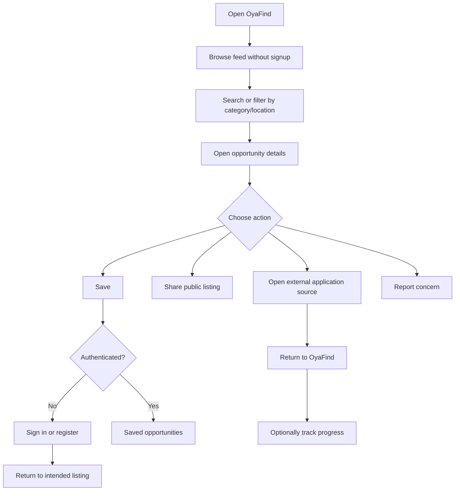

# OyaFind — MVP Product Requirements Document

**Working tagline:** Real opportunities. Closer to you.  
**Market:** Nigeria — all 36 states and the Federal Capital Territory  
**Pilot horizon:** 30 days  
**Product form:** Mobile-first, installable PWA (working assumption)  
**Status:** Approved PRD baseline; this decision update is pending user approval  
**Source of truth:** The supplied OyaFind brief. Where it is silent, this PRD labels assumptions and open decisions instead of presenting them as validated policy.

## 1. Executive summary

OyaFind helps people discover and assess legitimate, relevant opportunities: jobs, gigs, internships, scholarships, training, grants, business support and tenders. The product covers the Nigerian market and the needs of students, jobseekers, graduates, skilled workers and young entrepreneurs. The service remains open to everyone; audience needs are supported through categories, search and location filters rather than eligibility gates.

The MVP is intended to validate that people can find opportunities relevant to their circumstances, trust OyaFind enough to return, and that organisations see value in reaching local candidates or participants. Public browsing, search, details and sharing must work without an account. Registration is required to save opportunities and use the private application tracker. Trust is supported by review workflows, visible verification states, evidence records, user reports, expiry handling and staff audit history.

The experience must be affordable to use, simple on Android phones and tolerant of intermittent or expensive connectivity. Location discovery in the MVP uses a searchable picker of reviewed coarse areas, served from OyaFind's own location catalogue; it does not use GPS, address geocoding or an interactive map. The 30-day pilot is an evidence-gathering launch, not a commitment to a particular commercial model.

**Implementation status (snapshot: 2026-10-22):** The application foundation and core schema are implemented (tasks 1–2). The location catalogue API is being developed; its completion is not yet confirmed. No user features are implemented yet. No live database connection or migration against the user's MySQL `oyafind` database has been confirmed.

## 2. Opportunity discovery and verification

### 2.1 Opportunity to be addressed

People looking for work, education and business support often encounter opportunities scattered across sources and social channels. They need a low-friction way to find locally relevant listings, understand eligibility and deadlines, judge how recently a listing was checked, and reach the original application channel. Organisations need a credible way to reach relevant people in their state or LGA. The brief identifies these needs as the product hypothesis; it does not include quantified user research or validated demand.

### 2.2 Evidence status and validation plan

The supplied brief establishes the intended audiences, national geography, core product hypothesis, candidate opportunity types and 30-day validation goals. It does **not** establish measured demand, verified conversion rates, willingness to pay, contact-verification delivery provider, verification service-level targets, or numeric success thresholds. These must not be represented as research findings.

During the pilot, the team should collect evidence that can confirm or challenge each hypothesis:

| Hypothesis | MVP evidence to collect | Interpretation |
|---|---|---|
| People can find relevant opportunities | Search/filter use, listing-detail views, application-source clicks, short user interviews | Determine whether categories, location and listing information support discovery |
| People trust OyaFind enough to return | Repeat visits, saved listings, verification-label comprehension, report volume and resolution, interviews | Do not equate a “verified” badge with guaranteed outcomes |
| Organisations see value in local reach | Number of participating organisations, submitted/accepted listings, provider feedback and repeat submissions | Interest is validation evidence, not proof of willingness to pay |
| The experience is usable with constrained data and Android devices | Page weight, load/error measures on representative devices and networks, task-based usability | Use actual pilot device/network observations; do not assume high-end phones or unlimited data |

**Discovery constraint:** Product analytics must not collect unnecessary personal information. Interview recruitment, incentives, consent and data retention are operational decisions to approve before research begins.

### 2.3 Trust model and user-facing meaning

- A listing's **publication status** answers whether OyaFind currently displays it.
- A listing's **verification status** describes the outcome/status of OyaFind's checks. It is not an endorsement, a guarantee that the provider is safe, or a guarantee of selection or payment.
- Only opportunities whose source and details have been verified may be published publicly. “Verified” must never be synthesized from submission, staff approval, missing information or an assumed check. The qualifying checklist, evidence standard, reviewer authorization and recheck mechanism remain open decisions; until those are defined, no listing may be assigned or presented as verified.
- Public users must be able to report suspicious, inaccurate, expired or otherwise problematic listings without first creating an account. Reports are triaged by authorised staff.
- The supplied brief does not define the exact verification checklist, evidence standard, reviewer authorization, recheck mechanism, evidence-retention duration, badge copy, or report response-time commitments. The policy decisions that are fixed and those still open are recorded in §5.3.

## 3. Product goals, scope and non-goals

### 3.1 MVP goals

1. Make relevant opportunities discoverable by category, text search and state/LGA location.
2. Make listing source, eligibility, application method, deadline and verification state understandable.
3. Let users browse and share public listings without signup; let signed-in users save listings and privately track their own application progress.
4. Give authorised staff the minimum tools to review submissions, record verification evidence, handle reports and expire or archive listings.
5. Deliver a usable, accessible, low-data mobile experience for the national launch while keeping the service open to people outside the primary audiences.

### 3.2 In scope

- Public, paginated opportunity feed, search, category and location filters, listing details and sharing.
- National launch geography through a searchable coarse location/area picker covering all 36 states and the FCT; selectable areas are published only after their names and hierarchy are human-reviewed.
- Account registration, sign-in, sign-out and basic profile/preferences.
- Save/unsave listings and a private, manually maintained application tracker.
- Listing submission by an authorised submitter, with staff review before public publication.
- Publication and verification labels kept distinct; evidence-backed verification history.
- Anonymous or signed-in listing reports, staff moderation and audit records.
- Deadline-based expiry, manual status changes and basic user notifications.
- Minimal pilot analytics and operational monitoring.
- PWA installability and conservative offline access to the app shell and explicitly cached public content.

### 3.3 Out of scope for MVP

- In-app payments, wallet, paid employer accounts or paid/sponsored placements.
- Social network, comments, direct messaging, video feed or user-to-user contact exchange.
- AI matching, complex recommendations, advanced employer analytics or premium career tools.
- A claim of comprehensive coverage of every opportunity in Nigeria.
- OyaFind processing applications, deciding hiring outcomes, awarding grants or guaranteeing a listing/provider.
- Automated identity/background checks, automated fraud adjudication or automated verification.
- GPS location, exact-address collection, address geocoding, interactive maps/map tiles, or runtime requests to third-party location services.
- Native Android application. The MVP is a web/PWA experience; native app consideration is a later decision.

## 4. Users, roles and permissions

### 4.1 User groups

| User group | Primary needs |
|---|---|
| Students | Scholarships, internships, training and entry-level work |
| Jobseekers and workers | Employment, part-time work and local gigs |
| Graduates | Entry-level roles, internships, training and grants |
| Skilled workers and apprentices | Trade work, gigs and vocational training |
| Young entrepreneurs and traders | Grants, business support and tenders |
| Employers and organisations | Reach relevant local candidates or participants |
| General public | Browse, assess, share and report opportunities |
| OyaFind operations staff | Review listings, verify claims, respond to reports and keep listings current |

### 4.2 Roles and permission rules

Role assignment and every protected action are enforced by the server. The client UI is not an authorization boundary.

| Role | MVP permissions |
|---|---|
| Anonymous visitor | Read published, non-expired public listings and taxonomy; search/filter; share; submit a rate-limited report |
| Registered user | Visitor permissions plus manage own profile/preferences, bookmarks, application tracker and notification preferences |
| Contributor | Registered-user permissions plus submit listings and manage own draft/submission fields allowed by policy; cannot publish, verify or approve |
| Employer/organisation submitter | Contributor capabilities for its own submissions; no organization verification or paid account is implied |
| Moderator | Review submissions, approve/reject, manage reports, expire/archive listings and perform only explicitly granted verification actions |
| Administrator | Manage staff access, taxonomy/location data and operational configuration; review audit/summary metrics; does not bypass audit requirements |

**Confirmed policy:** Contributors and employer submitters must be approved by OyaFind staff before receiving submission access; every listing must be reviewed by staff before publication. Public self-service role escalation is not allowed. Staff roles must be provisioned by an administrator, never through public registration or profile updates.

**Least privilege:** Verification authority remains an open policy decision and must be explicitly authorized before it is used. No role may read another user's saved list, application notes or private profile data.

## 5. Assumptions and open decisions

### 5.1 Explicit MVP assumptions (not validated facts)

1. The launch is national, covering all 36 states and the Federal Capital Territory, with optional finer areas only after the location list is human-validated. The exact geography approver remains open. No precise home address is required.
2. Public listing access does not require registration. Saving and application tracking require registration and authentication.
3. Application tracking is a private user-maintained record. OyaFind does not receive external application results automatically.
4. A listing with a known deadline becomes expired when that deadline passes. A listing without a deadline must be rechecked by staff every 30 days from publication or its last completed recheck; when the 30-day interval is overdue, it must be hidden from public access and treated as expired until rechecked.
5. Every listing is reviewed by staff before publication, and only an opportunity whose source and details have been verified may be published publicly. Staff review alone does not constitute source/detail verification. The verification checklist, evidence standard, reviewer authorization and recheck mechanism remain open; OyaFind must not synthesize a verified state.
6. Notifications are in-app only in the MVP; push notifications are out of scope.
7. Amounts are optional structured values with a currency code; the product must not infer or fabricate salary, grant size or fees.
8. The backend returns public responses without internal notes, submitter contact details or private verification evidence.

### 5.2 Confirmed stack and technical assumptions

The user has confirmed Laravel 12 on PHP 8.2, Vue 3, and MySQL with database name `oyafind`. The mobile-first, installable PWA remains the product-form assumption. These are product decisions, not evidence of deployment or a working database connection:

- Front end: Vue 3, with the mobile-first, installable PWA assumption retained.
- Backend: Laravel 12 on PHP 8.2.
- Database: MySQL, database name `oyafind`.
- Current scaffold implementation snapshot: local PHP CLI 8.2.33, resolved Laravel framework 12.70.1 and Vue 3.5.44. These exact versions describe the newly bootstrapped app snapshot; they do not establish deployed versions or a MySQL server version.
- Authentication: secure first-party session cookies with CSRF protection where deployment permits; otherwise a deliberately configured secure alternative.
- Scheduled work: scheduler/queue for expiry and optional reminders.
- Hosting: HTTPS, protected secrets, backups, monitoring and an agreed restore procedure.

The code foundation exists, but no live database connection or migration against the user's `oyafind` database has been performed. No deployed application or MySQL server version is asserted.

### 5.3 Open decisions requiring product/operations approval

1. Contact verification implementation: the registration policy is email OR phone plus password, and a verified contact is required before a user can save an opportunity. The exact email/phone verification flow and delivery provider remain open; no phone-verification delivery capability is asserted.
2. Verification checklist: which source/detail checks qualify for publication as verified, what evidence standard applies, who is authorized to verify, and how verification is rechecked. No “verified” state may be inferred or synthesized before an authorized check meets the approved policy.
3. Verification recheck operations for published listings, including how checks are scheduled and recorded; independently, no-deadline listings must be rechecked every 30 days and hidden/expired when overdue.
4. Report handling: exact report reasons, triage priority and response SLA; anonymous-report abuse controls and abuse thresholds; whether contact details are ever requested.
5. Account deletion, data-retention periods, privacy/legal policy, analytics consent and evidence retention.
6. Whether employer/organisation records need a separate entity or whether organisation name on each listing is sufficient for pilot validation.
7. Numeric launch success thresholds and who owns approval to continue, adjust or stop after day 30.
8. The national location/area taxonomy, the exact approver for geography, and ownership of ongoing maintenance of labels and hierarchy.
9. Currency display convention, salary range representation and whether compensation visibility is optional or required for specific listing categories.
10. Hosting/deployment details, including the deployed environment and operational ownership.

**Decisions confirmed:** Registration uses email OR phone plus password, and the selected contact must be verified before the user can save an opportunity; verification implementation and delivery provider remain open. Contributor/employer access requires staff approval; every listing requires staff review before publication; only source/detail verified opportunities may be published publicly, with no synthesized verified state. No-deadline listings are rechecked every 30 days and hidden/expired when overdue. Notifications are in-app only, with no push. The tracker status list is `interested`, `preparing`, `applied`, `interview`, `successful`, `unsuccessful`, and `user-reported`. The confirmed stack is Laravel 12 on PHP 8.2, Vue 3, and MySQL database `oyafind`; the mobile-first installable PWA remains the product-form assumption. The MVP location experience is a searchable, coarse, OyaFind-owned location/area picker only; GPS, exact-address collection, geocoding, interactive maps/map tiles and third-party runtime location services are out of scope. Exact selectable area names and the exact geography approver remain open. Account deletion/data retention, report response SLA/reasons/abuse thresholds, and privacy/legal policy remain open.

### 5.4 Free geography data source — decision record

**Decision: `osm_optional`.** OyaFind may perform a one-time use/import from an appropriately bounded OSM/Geofabrik-derived source as a seed/reference for its own location catalogue, subject to an actual documented ODbL licensing review before use and human validation before choices become selectable. This does not authorize ongoing synchronization or establish that licensing review or human validation has already occurred. Applicable attribution and share-alike obligations must be met; imported data must retain source/provenance, retrieval date and dataset version or snapshot identifier. Serve choices from OyaFind's own catalogue; do not make the picker depend on a live third-party locator.

- OpenStreetMap data is available under the ODbL; provide required attribution and license notice: [OpenStreetMap copyright and license](https://www.openstreetmap.org/copyright).
- [Geofabrik's Nigeria extract](https://download.geofabrik.de/africa/nigeria.html) is a free raw PBF download, not a confirmed, ready-to-use Nigerian state/LGA taxonomy. It is community-maintained source data; free access does not guarantee completeness, accuracy, currency or zero operating cost.
- Geofabrik's [technical notes](https://download.geofabrik.de/technical.html) distinguish its extract clipping polygon from actual administrative boundaries; the extract boundary must not be treated as authoritative geography.
- Public [Nominatim usage policy](https://operations.osmfoundation.org/policies/nominatim/) limits use to at most one request per second and prohibits client-side autocomplete and systematic complete-place queries. Do not use the public Nominatim service as the runtime or autocomplete source for this preloaded picker.

Exact selectable area names and the person/team accountable for validation remain open. Do not infer or publish unconfirmed state, LGA or neighbourhood names. Include OSM attribution/ODbL disclosure and meet applicable share-alike obligations as established by the licensing review wherever required for displayed or derived data.

## 6. Functional requirements and user stories

Acceptance criteria use EARS keywords (`WHEN`, `IF`, `WHERE`, `WHILE`) followed by mandatory `SHALL` behavior. Thresholds marked **proposed** are product targets for confirmation, not validated research.

### Requirement 1 — Discover opportunities

**User Story:** As a student, jobseeker, graduate, skilled worker, entrepreneur or other visitor, I want to browse relevant opportunities without creating an account, so that I can quickly find options that fit my needs.

#### Acceptance Criteria

1. WHEN a visitor opens the home/feed route THEN OyaFind SHALL show a paginated list of currently published, staff-reviewed opportunities with verified source and details, and SHALL not require authentication.
2. WHEN a visitor selects a category, location, work mode or supported sort order THEN OyaFind SHALL return only listings matching validated filter values and SHALL preserve the selection in a shareable or reloadable URL.
3. WHEN a visitor submits a text query THEN OyaFind SHALL search supported public listing fields and SHALL return a useful empty state when no listing matches.
4. WHEN a visitor opens an opportunity detail route THEN OyaFind SHALL show the public title, category, organisation/provider name, location, summary, full details, eligibility/requirements when available, application method, source/application link when available, deadline when known, publication state and verification state for a staff-reviewed opportunity whose source and details have been verified.
5. IF a listing is not published, is expired, is archived, or has been removed THEN OyaFind SHALL not expose it through public feeds or public detail responses.
6. WHEN the feed has more results than the page size THEN OyaFind SHALL provide bounded pagination and SHALL not require downloading the complete catalogue.
7. WHEN no location preference exists THEN OyaFind SHALL allow browsing all public listings or choosing a location without blocking the visitor.
8. WHEN the visitor shares a listing THEN OyaFind SHALL provide a stable public URL that does not disclose private user or moderation information.
9. WHEN a visitor opens or searches the coarse location picker THEN OyaFind SHALL show matching active choices from OyaFind's own API and SHALL restrict selectable names and hierarchy to human-reviewed location records.
10. WHILE the MVP location picker is in use THEN OyaFind SHALL NOT request device GPS, collect an exact address, call a geocoder or external locator, or load interactive map tiles.
11. WHERE a displayed location choice is derived from OpenStreetMap data THEN OyaFind SHALL meet the applicable attribution and share-alike obligations identified by the documented ODbL review and SHALL provide the required OpenStreetMap attribution and ODbL notice.

### Requirement 2 — Understand listing trust and report concerns

**User Story:** As an opportunity seeker, I want clear verification information and a simple way to report a concern, so that I can make an informed decision and alert OyaFind to possible problems.

#### Acceptance Criteria

1. WHEN a listing is shown publicly THEN OyaFind SHALL display its verification state using approved, understandable copy and SHALL distinguish it from publication status; every publicly available listing SHALL have source and details verified.
2. IF a listing is marked verified THEN OyaFind SHALL have an attributable record of the source/detail check, its result and supporting evidence as required by the approved verification policy; OyaFind SHALL NOT infer or synthesize a verified state. The exact checklist, evidence standard, reviewer authorization and recheck mechanism remain open decisions.
3. WHEN a visitor submits a report THEN OyaFind SHALL accept a supported reason, optional explanation and listing reference without requiring signup, subject to abuse controls.
4. WHEN a report is accepted THEN OyaFind SHALL acknowledge receipt without exposing the reporter's information or internal review details publicly.
5. WHEN an authorised moderator reviews a report THEN OyaFind SHALL allow the moderator to record a disposition and SHALL retain an attributable audit event.
6. IF a listing is flagged or otherwise restricted by authorised staff THEN OyaFind SHALL apply the approved public visibility/label policy and SHALL prevent the status from being silently cleared without an audit record.
7. WHERE verification evidence is stored THEN OyaFind SHALL restrict access to authorised staff and SHALL never include private evidence or internal notes in public API responses.
8. WHEN verification has become stale under the approved recheck policy THEN OyaFind SHALL no longer represent the listing as currently verified until a new authorized check is recorded; the applicable recheck mechanism remains open.

### Requirement 3 — Register and manage an account

**User Story:** As a returning user, I want a simple account and preference profile, so that I can save opportunities and continue using OyaFind across visits.

#### Acceptance Criteria

1. WHEN a visitor registers THEN OyaFind SHALL accept an email OR phone number as the account identifier together with a password, create a user account with the least-privileged public role, and SHALL not accept a client-supplied moderator, administrator or elevated contributor role.
2. WHEN a user signs in with valid credentials THEN OyaFind SHALL establish an authenticated session using the approved secure authentication mechanism.
3. WHEN a user signs out THEN OyaFind SHALL invalidate the session and any associated refresh/session credential according to the selected authentication model.
4. WHEN an authenticated user views or updates a profile THEN OyaFind SHALL return or update only that user's permitted profile fields and preferences.
5. IF an account is suspended or otherwise inactive THEN OyaFind SHALL deny protected actions and SHALL provide a non-disclosing, actionable sign-in message.
6. WHEN registration or login fails validation or authentication THEN OyaFind SHALL return a safe, understandable error without revealing whether unrelated accounts exist.
7. WHEN a registered user attempts to save an opportunity THEN OyaFind SHALL require the account's selected email or phone contact to be verified before allowing the save.
8. WHERE the user chooses a home area or interests THEN OyaFind SHALL treat these as optional preferences and SHALL not require a precise residential address.

### Requirement 4 — Save and manage opportunities

**User Story:** As a registered user, I want to bookmark opportunities, so that I can return to them later.

#### Acceptance Criteria

1. WHEN an unauthenticated visitor selects Save THEN OyaFind SHALL route the visitor to sign-in/registration and SHALL preserve the intended return destination where safe.
2. WHEN an authenticated user with a verified registration contact saves a public opportunity THEN OyaFind SHALL create at most one saved record for that user and opportunity.
3. IF an authenticated user's registration contact is not verified THEN OyaFind SHALL deny saving and SHALL explain that contact verification is required without claiming a verification delivery method that is not available.
4. WHEN an authenticated user removes a saved opportunity THEN OyaFind SHALL remove only that user's saved record.
5. WHEN a user opens the saved list THEN OyaFind SHALL display only that user's saved opportunities and clearly identify listings that are now expired or unavailable.
6. IF a saved listing is no longer public THEN OyaFind SHALL not expose its restricted details through the saved-list response and SHALL provide a suitable unavailable/expired state.
7. WHEN a repeated save request is received for an already-saved opportunity THEN OyaFind SHALL handle it idempotently without creating a duplicate.

### Requirement 5 — Track applications privately

**User Story:** As a registered opportunity seeker, I want to keep my own application progress and notes, so that I can organise follow-up without OyaFind pretending to know the external outcome.

#### Acceptance Criteria

1. WHEN a user starts tracking an opportunity THEN OyaFind SHALL create or update one private tracker record for that user and opportunity.
2. WHEN a user updates tracker status THEN OyaFind SHALL accept only `interested`, `preparing`, `applied`, `interview`, `successful`, `unsuccessful` or `user-reported`, and SHALL identify the status as user-reported.
3. WHEN a user saves notes or an applied date THEN OyaFind SHALL make those fields readable only by that user and explicitly authorised support roles where policy permits.
4. IF a user requests another user's tracker record THEN OyaFind SHALL deny access regardless of client-supplied identifiers or role claims.
5. WHEN a tracker record is displayed THEN OyaFind SHALL not imply that an application was submitted through OyaFind or that an employer confirmed an outcome.
6. WHEN an opportunity expires or is removed THEN OyaFind SHALL retain or hide the user's tracker record according to the approved retention policy without exposing the listing publicly.

### Requirement 6 — Submit and moderate opportunities

**User Story:** As an approved contributor or organisation, I want to submit a complete opportunity for review, so that OyaFind can publish useful local listings with appropriate checks.

#### Acceptance Criteria

1. WHEN a staff-approved contributor or employer submits a valid listing THEN OyaFind SHALL save it as a draft or pending review and SHALL not publish it automatically.
2. WHEN a submission is missing required fields or contains invalid values THEN OyaFind SHALL reject it with field-specific, accessible feedback and SHALL not create a publicly visible listing.
3. WHEN staff reviews a listing THEN OyaFind SHALL record the review decision, actor and time; every listing SHALL receive staff review before publication.
4. IF a staff-reviewed listing does not have a source and details verified under the approved verification policy THEN OyaFind SHALL NOT publish it publicly.
5. WHEN an authorised moderator rejects a submission THEN OyaFind SHALL record a reason and SHALL make that reason visible only to permitted submitter/staff audiences according to policy.
6. IF a submitter edits a previously approved listing in a material way THEN OyaFind SHALL apply the approved re-review policy and SHALL not silently retain an outdated verification claim.
7. WHEN a moderator changes a listing's publication or verification state THEN OyaFind SHALL validate the permitted state transition and record an audit event.
8. WHEN a contributor attempts to approve, verify, expire or edit another contributor's restricted submission THEN OyaFind SHALL deny the action unless an explicit policy grants that permission.
9. WHERE a listing includes URLs or descriptive text THEN OyaFind SHALL validate and safely render input, and SHALL not execute submitted markup or scripts.

### Requirement 7 — Expire, refresh and notify

**User Story:** As an opportunity seeker, I want expired listings clearly handled, so that I do not waste time applying to closed opportunities.

#### Acceptance Criteria

1. WHEN a published opportunity has a deadline at or before the system's defined current time THEN OyaFind SHALL mark it expired or otherwise remove it from active public results according to the approved timezone policy.
2. WHEN an opportunity expires THEN OyaFind SHALL prevent new public application actions from being presented as current and SHALL retain authorized staff history.
3. WHEN a moderator manually expires, archives or restores a listing THEN OyaFind SHALL validate the transition and record the actor, time and reason.
4. IF a listing has no deadline THEN OyaFind SHALL require staff to recheck it every 30 days from publication or the last completed recheck; WHEN that interval is overdue THEN OyaFind SHALL hide the listing from public access and treat it as expired until it is rechecked.
5. WHEN a notification is generated THEN OyaFind SHALL deliver it only to the intended user through the in-app notification channel; OyaFind SHALL NOT send push notifications.
6. IF an offline cached listing is displayed after its cache age exceeds the configured freshness limit THEN OyaFind SHALL indicate that the content may be stale and SHALL not represent it as live or newly verified.

### Requirement 8 — Operate the pilot

**User Story:** As an OyaFind operator, I want to monitor listing quality and basic product use, so that I can keep the pilot safe and learn whether its goals are being met.

#### Acceptance Criteria

1. WHEN an authorised staff member opens the moderation queue THEN OyaFind SHALL show pending listings and relevant status, deadline, location and report counts needed for review.
2. WHEN an authorised administrator views the pilot summary THEN OyaFind SHALL show aggregate counts for published/expired listings, reports, search/detail activity and returning use without exposing private tracker notes.
3. WHEN an operational or security-relevant staff action occurs THEN OyaFind SHALL record an attributable audit event with actor, action, entity, timestamp and appropriate metadata.
4. IF staff access is revoked or an account is suspended THEN OyaFind SHALL immediately prevent subsequent protected operations for that account.
5. WHEN the scheduled expiry task fails or falls behind its configured schedule THEN OyaFind SHALL expose an operational signal for staff rather than silently leaving known expired content active.
6. IF OyaFind proposes a one-time import from an OSM/Geofabrik-derived source THEN OyaFind SHALL complete a documented ODbL licensing review, including applicable attribution and share-alike obligations, before importing; WHEN such a location record is imported THEN OyaFind SHALL retain its source/provenance reference, retrieval date and dataset version or snapshot identifier, and SHALL not publish it as selectable until a human has validated its label and hierarchy.

## 7. Non-functional requirements

### 7.1 Low-data, mobile and performance

1. WHEN the feed is requested THEN OyaFind SHALL return bounded, paginated results (proposed default 20 items) and SHALL avoid loading full-resolution media by default.
2. WHILE a user browses on a mobile connection THEN OyaFind SHALL prioritize text and essential controls, defer nonessential assets and avoid autoplay media.
3. WHEN the PWA is installed or revisited THEN OyaFind SHALL cache the application shell and only explicitly selected public content; it SHALL NOT place authentication responses, account data, reports, tracker notes or administration pages in a public service-worker cache.
4. IF a network request cannot complete THEN OyaFind SHALL show an understandable offline/error state and SHALL not present unsent reports, saves or status changes as successfully persisted.
5. WHEN a user returns online after an offline period THEN OyaFind SHALL refresh public data and clearly resolve any stale state before the user relies on it.
6. **Proposed performance target for approval:** WHEN tested on a representative Android device and agreed pilot mobile network THEN the primary feed/detail routes SHALL meet a p75 Largest Contentful Paint of 2.5 seconds or less, and the initial compressed transfer budget SHALL be agreed and measured before launch. These numbers are targets, not validated current performance.
7. WHEN the location picker is opened THEN OyaFind SHALL load a bounded, searchable set of choices from its own reviewed location catalogue and SHALL avoid a third-party locator request for each opening or search.
8. IF the network is unavailable and a previously loaded public location catalogue is available locally THEN OyaFind SHALL allow the user to view and select from that cached catalogue while indicating its cached state; IF no local catalogue is available THEN OyaFind SHALL show a recoverable picker error and SHALL keep all-location browsing available.

### 7.2 Accessibility and usability

1. WHEN any core route is used with keyboard navigation or assistive technology THEN OyaFind SHALL expose semantic structure, visible focus, programmatic labels and meaningful status/error announcements.
2. WHEN content is rendered THEN OyaFind SHALL meet WCAG 2.2 AA contrast and interaction expectations to the extent testable for the MVP.
3. WHEN a form has invalid fields THEN OyaFind SHALL identify each issue in text, associate it with the relevant field and preserve safe user-entered values.
4. WHEN the viewport is a narrow Android phone THEN OyaFind SHALL keep primary actions reachable without horizontal scrolling or precision-only gestures.
5. WHEN verification, expiry, error or empty states are displayed THEN OyaFind SHALL use text and not color alone to convey meaning.

### 7.3 Security, privacy and resilience

1. WHEN a request accesses a protected resource THEN OyaFind SHALL authenticate and authorize it on the server using the current principal and resource ownership/policy.
2. IF a client submits a different user ID, role or ownership value than its authenticated identity THEN OyaFind SHALL ignore or reject it and SHALL never grant access based on that value.
3. WHEN credentials are stored THEN OyaFind SHALL store only appropriately salted password hashes and SHALL never return passwords, tokens or secrets in API responses or logs.
4. WHEN a browser session is used THEN OyaFind SHALL apply secure cookie settings, CSRF protections and transport encryption consistent with the approved deployment.
5. WHEN APIs accept text, URLs, identifiers or filter values THEN OyaFind SHALL validate inputs, use safe query construction and encode output to mitigate injection and cross-site scripting risks.
6. WHEN login, registration, reporting or submission endpoints are used THEN OyaFind SHALL apply documented abuse controls and rate limits appropriate to the operation.
7. WHEN data is deleted or a listing is removed THEN OyaFind SHALL preserve required audit history while following an approved retention/deletion policy for personal data.
8. WHEN backups are created THEN OyaFind SHALL protect them from public access and document restore ownership and procedure before pilot launch.
9. WHEN a third-party service processes user data THEN OyaFind SHALL disclose the relevant data use and SHALL not expose provider secrets in the client; OyaFind SHALL NOT use push notification services in the MVP.

### 7.4 API and operational quality

1. WHEN public or authenticated API responses are returned THEN OyaFind SHALL use stable, documented date/time serialization and consistent pagination/error formats.
2. WHEN database-backed moderation actions affect multiple records THEN OyaFind SHALL preserve data consistency through an atomic operation or equivalent recovery behavior.
3. WHEN a monitoring event is emitted THEN OyaFind SHALL avoid collecting passwords, session secrets, private application notes or unnecessary personal data.
4. WHEN the service is deployed THEN OyaFind SHALL serve the PWA and API over HTTPS and SHALL expose a health/availability signal to operators.
5. WHEN a deployment or scheduled job fails THEN OyaFind SHALL provide enough operational logging to diagnose the issue without leaking secrets or private user content.

## 8. MVP data model

The following is a complete proposed relational MVP model derived from the brief, not a statement of existing tables. Types are logical MySQL-oriented types; exact engine/version and migration syntax are implementation decisions. All primary keys are unsigned big integers unless stated otherwise. Timestamps are UTC; user-visible dates are localized consistently. Foreign keys, unique constraints and indexes below are requirements.

### 8.1 `users`

| Field | Type | Null | Constraints/meaning |
|---|---|---:|---|
| `id` | BIGINT PK | No | Generated |
| `name` | VARCHAR(120) | No | Public display name where applicable |
| `email` | VARCHAR(190) | Yes | Unique when present; verification timestamp separate |
| `phone` | VARCHAR(25) | Yes | Normalized; unique when present |
| `password_hash` | VARCHAR(255) | No | One-way password hash; never returned |
| `role` | ENUM(`user`,`contributor`,`employer`,`moderator`,`admin`) | No | Default `user`; elevated roles assigned only by staff |
| `home_location_id` | BIGINT FK locations | Yes | Coarse optional area; never a precise address |
| `interests` | JSON or normalized relation | Yes | Category IDs/preferences; validate against active categories |
| `status` | ENUM(`pending`,`active`,`suspended`) | No | Default per approved registration policy |
| `email_verified_at` | DATETIME | Yes | Null until verified |
| `phone_verified_at` | DATETIME | Yes | Null until verified |
| `created_at`,`updated_at` | DATETIME | No | UTC |

**Constraints:** the account registration identifier is email OR phone, with a password; enforce uniqueness for any stored email/phone value. A user must have the selected contact verified before saving an opportunity. The exact verification flow and delivery provider remain open; do not infer that phone-verification delivery works. Never accept `role`, status or verification timestamps from public profile updates.

### 8.2 `locations`

| Field | Type | Null | Constraints/meaning |
|---|---|---:|---|
| `id` | BIGINT PK | No | Generated |
| `name` | VARCHAR(120) | No | Display name |
| `slug` | VARCHAR(150) | No | Unique URL/filter key |
| `parent_id` | BIGINT FK locations | Yes | Self-reference for hierarchy |
| `location_type` | ENUM(`country`,`state`,`city`,`lga`,`neighbourhood`) | No | Geographic level |
| `is_active` | BOOLEAN | No | Whether selectable |
| `source_name` | VARCHAR(120) | Yes | Source for imported records, e.g. OpenStreetMap |
| `source_reference` | VARCHAR(500) | Yes | Provenance/source reference for imported records |
| `source_version` | VARCHAR(120) | Yes | Source dataset version or snapshot identifier |
| `source_retrieved_at` | DATE | Yes | Retrieval date for imported source data |
| `created_at`,`updated_at` | DATETIME | No | UTC |

**Constraints:** unique `slug`; parent deletion restricted while children/listings refer to it. Seed only human-confirmed geography and area records. Do not model a state as a single LGA.

For imported rows, populate the source/provenance fields, retrieval date and dataset version or snapshot identifier. These fields support traceability and do not imply that imported geography is authoritative or that an automated data pipeline is required.

### 8.3 `categories`

| Field | Type | Null | Constraints/meaning |
|---|---|---:|---|
| `id` | BIGINT PK | No | Generated |
| `name` | VARCHAR(100) | No | Display name |
| `slug` | VARCHAR(120) | No | Unique stable identifier |
| `description` | TEXT | Yes | Short explanation |
| `icon_key` | VARCHAR(80) | Yes | UI key only, not arbitrary markup |
| `is_active` | BOOLEAN | No | Selectable/displayed state |
| `sort_order` | INT | No | Nonnegative display ordering |
| `created_at`,`updated_at` | DATETIME | No | UTC |

**Seed categories:** Jobs, Gigs, Internships, Scholarships, Training, Grants, Business Support and Tenders. Category taxonomy changes are staff-only.

### 8.4 `opportunities`

| Field | Type | Null | Constraints/meaning |
|---|---|---:|---|
| `id` | BIGINT PK | No | Generated |
| `category_id` | BIGINT FK categories | No | Active category for new submissions |
| `location_id` | BIGINT FK locations | Yes | Relevant area; null means location not specified |
| `submitted_by` | BIGINT FK users | No | Submitter; preserve attribution |
| `title` | VARCHAR(200) | No | Required |
| `slug` | VARCHAR(230) | No | Unique stable public route |
| `summary` | VARCHAR(300) | No | Card excerpt |
| `description` | LONGTEXT | No | Plain text/sanitized structured content |
| `organisation_name` | VARCHAR(200) | No | Provider name as supplied/checked |
| `source_url` | VARCHAR(2048) | Yes | Original source; validated URL |
| `application_url` | VARCHAR(2048) | Yes | Application destination; validated URL |
| `application_method` | ENUM(`external_url`,`email`,`in_person`,`instructions`) | No | How to apply |
| `application_instructions` | TEXT | Yes | Public instructions; must not expose private internal notes |
| `opportunity_type` | ENUM(`job`,`gig`,`scholarship`,`training`,`grant`,`tender`,`other`) | No | Type; may align with category |
| `work_mode` | ENUM(`onsite`,`remote`,`hybrid`,`not_applicable`) | Yes | Work mode where relevant |
| `eligibility` | TEXT | Yes | Who can apply |
| `requirements` | JSON | Yes | Validated list of criteria/documents |
| `amount_min` | DECIMAL(12,2) | Yes | Optional; nonnegative |
| `amount_max` | DECIMAL(12,2) | Yes | Optional; >= `amount_min` when both supplied |
| `currency` | CHAR(3) | Yes | ISO currency code when amount exists |
| `deadline_at` | DATETIME | Yes | UTC; null means no stated deadline |
| `status` | ENUM(`draft`,`pending_review`,`published`,`rejected`,`expired`,`archived`) | No | Publication lifecycle; default draft |
| `verification_status` | ENUM(`unverified`,`pending`,`verified`,`flagged`) | No | Separate trust status; default unverified |
| `published_at` | DATETIME | Yes | Set on publication |
| `verified_at` | DATETIME | Yes | Latest successful check time |
| `verified_by` | BIGINT FK users | Yes | Reviewer authorized under the verification policy; authorization criteria remain open |
| `view_count` | BIGINT UNSIGNED | No | Aggregate count only; default 0; avoid personal view profile |
| `created_at`,`updated_at` | DATETIME | No | UTC |
| `deleted_at` | DATETIME | Yes | Optional soft deletion; audit-preserving removal |

**Constraints and indexes:** unique slug; foreign keys to category, location, submitter and reviewer; index `(status,published_at)`, `(category_id,status)`, `(location_id,status)`, `deadline_at`, and searchable fields appropriate to the selected DB. Public publication requires both completed staff review and source/detail verification under the approved policy. Amount fields must be internally consistent. Do not add `is_sponsored` to the MVP as paid/sponsored listings are out of scope; if the pilot later needs editorial featuring, approve its meaning and labeling separately.

### 8.5 `saved_opportunities`

| Field | Type | Null | Constraints/meaning |
|---|---|---:|---|
| `id` | BIGINT PK | No | Generated |
| `user_id` | BIGINT FK users | No | Owner |
| `opportunity_id` | BIGINT FK opportunities | No | Saved listing |
| `created_at` | DATETIME | No | UTC |

**Constraints:** unique (`user_id`,`opportunity_id`); cascade user-owned bookmark on account deletion only after approved deletion policy; listing deletion must not erase required audit data.

### 8.6 `user_applications`

| Field | Type | Null | Constraints/meaning |
|---|---|---:|---|
| `id` | BIGINT PK | No | Generated |
| `user_id` | BIGINT FK users | No | Owner |
| `opportunity_id` | BIGINT FK opportunities | No | Related opportunity |
| `status` | ENUM(`interested`,`preparing`,`applied`,`interview`,`successful`,`unsuccessful`,`user-reported`) | No | Confirmed tracker status set; user-reported |
| `notes` | TEXT | Yes | Private user notes |
| `applied_at` | DATETIME | Yes | User-provided; UTC |
| `created_at`,`updated_at` | DATETIME | No | UTC |

**Constraints:** unique (`user_id`,`opportunity_id`); all reads and writes scoped to the authenticated owner; no public endpoint. The status list above is confirmed.

### 8.7 `opportunity_reports`

| Field | Type | Null | Constraints/meaning |
|---|---|---:|---|
| `id` | BIGINT PK | No | Generated |
| `opportunity_id` | BIGINT FK opportunities | No | Reported listing |
| `user_id` | BIGINT FK users | Yes | Null for anonymous reports |
| `reason` | ENUM(`suspected_scam`,`incorrect_information`,`expired_or_closed`,`misleading`,`other`) | No | Controlled list; proposed pending approval |
| `details` | TEXT | Yes | Limited, validated text; warn against unnecessary sensitive information |
| `status` | ENUM(`open`,`in_review`,`resolved`,`dismissed`) | No | Default open |
| `resolved_by` | BIGINT FK users | Yes | Authorized staff |
| `resolution_note` | TEXT | Yes | Internal, staff-only |
| `created_at`,`updated_at` | DATETIME | No | UTC |
| `resolved_at` | DATETIME | Yes | UTC |

**Constraints:** staff-only resolution fields; rate-limit public creation; retain only under approved retention policy.

### 8.8 `opportunity_verifications`

| Field | Type | Null | Constraints/meaning |
|---|---|---:|---|
| `id` | BIGINT PK | No | Generated |
| `opportunity_id` | BIGINT FK opportunities | No | Checked listing |
| `reviewer_id` | BIGINT FK users | No | Authorized reviewer |
| `result` | ENUM(`verified`,`not_verified`,`needs_follow_up`,`flagged`) | No | Result of this check |
| `check_type` | VARCHAR(80) | No | Controlled/configured check kind once policy approved |
| `evidence_url` | VARCHAR(2048) | Yes | Restricted evidence reference; validate URL |
| `evidence_summary` | TEXT | Yes | Restricted description or rationale |
| `notes` | TEXT | Yes | Internal, access-controlled notes |
| `checked_at` | DATETIME | No | UTC |
| `created_at` | DATETIME | No | UTC |

**Constraints:** append-only audit trail; do not overwrite prior checks. Update current opportunity verification fields only when a check satisfies the approved policy; never synthesize a verified state. Evidence access is restricted. The qualifying checklist, evidence standard, reviewer authorization and recheck mechanism remain open.

### 8.9 `notifications`

| Field | Type | Null | Constraints/meaning |
|---|---|---:|---|
| `id` | BIGINT PK | No | Generated |
| `user_id` | BIGINT FK users | No | Recipient |
| `type` | VARCHAR(80) | No | Allowlisted notification type |
| `data` | JSON | No | Minimal safe payload; no secrets |
| `read_at` | DATETIME | Yes | UTC |
| `created_at` | DATETIME | No | UTC |

**Constraints:** only recipient can read/mark read; validate payload; user-facing notifications do not expose staff-only notes.

### 8.10 Push notifications (out of scope)

Push notifications and push subscriptions are not part of the MVP. The data model SHALL NOT include push endpoints or subscription keys; user notifications are in-app only.

### 8.11 `audit_logs`

| Field | Type | Null | Constraints/meaning |
|---|---|---:|---|
| `id` | BIGINT PK | No | Generated |
| `actor_id` | BIGINT FK users | Yes | Null only for explicitly system-generated event |
| `action` | VARCHAR(100) | No | Controlled action name |
| `entity_type` | VARCHAR(100) | No | Allowlisted entity |
| `entity_id` | BIGINT | Yes | Target identifier |
| `metadata` | JSON | Yes | Minimal, non-secret before/after context |
| `created_at` | DATETIME | No | UTC |

**Constraints:** append-only to application roles; never store credentials, private notes or unnecessary personal data. Retention and administrator access must be approved.

### 8.12 Referential integrity and indexing summary

- Foreign keys are required for ownership and taxonomy references. Deletion behavior must be deliberate; preserve compliance/audit evidence and avoid orphaned moderation records.
- Enforce unique email/phone when present, category/location slugs, opportunity slug, and user/opportunity uniqueness for saves and tracker records.
- Index public listing filters and sorting: `(status,published_at)`, `(category_id,status)`, `(location_id,status)`, `deadline_at`; index report queue status/creation time and user-owned tables by `user_id`.
- Use transactions for multi-record approval, verification, report resolution and expiry transitions.
- Full-text search mechanics are implementation choices; search must be bounded and must not expose unpublished content.

## 9. API requirements

All routes below are proposed under `/api/v1`. The response shape and exact field naming are implementation contracts to finalize; authorization requirements are normative. Public endpoints return only published, non-expired records and safe fields. Every endpoint validates inputs, returns consistent errors and is rate-limited where relevant.

### 9.1 Public read and report routes

| Method and route | Access | Purpose and key behavior |
|---|---|---|
| `GET /opportunities` | Public | Paginated feed; only staff-reviewed, source/detail verified, published and non-expired listings; allowlist `q`, `category`, `location`, `work_mode`, `deadline_before`, `sort`, `page`, `per_page` |
| `GET /opportunities/{slug}` | Public | Public detail only for staff-reviewed, source/detail verified, published and non-expired listing |
| `GET /opportunities/featured` | Public, optional | Only if a non-paid editorial feature policy is approved; otherwise omit from MVP |
| `GET /categories` | Public | Active categories, ordered |
| `GET /locations` | Public | Active, human-reviewed selectable location hierarchy from OyaFind's own catalogue; supports bounded search for picker choices |
| `POST /reports` | Public, rate-limited | Anonymous or authenticated report; no public retrieval endpoint |

`GET /opportunities` must not accept arbitrary SQL/order expressions. Proposed default page size is 20, with a server-enforced maximum. Invalid filter values return a validation error, not an unfiltered privileged query.

The location picker obtains its choices through OyaFind's own API/catalogue; public external geocoding, Nominatim autocomplete and map-tile requests are not part of the MVP.

### 9.2 Authentication and user routes

| Method and route | Access | Purpose |
|---|---|---|
| `POST /auth/register` | Public, rate-limited | Create least-privileged account |
| `POST /auth/login` | Public, rate-limited | Establish approved secure session |
| `POST /auth/logout` | Authenticated | Invalidate current session |
| `GET /me` | Authenticated | Current user's safe profile |
| `PATCH /me` | Authenticated | Update allowed profile/preferences only |
| `GET /me/notifications` | Authenticated | Own notifications |
| `PATCH /me/notifications/{id}` | Authenticated | Mark own notification read |

No profile route may change role, account status, staff permissions, email/phone verification state or another user's data.

### 9.3 Saves and application tracker

| Method and route | Access | Purpose |
|---|---|---|
| `GET /me/saved-opportunities` | Authenticated | List only own bookmarks |
| `PUT /me/saved-opportunities/{opportunity}` | Authenticated | Idempotently save a public listing |
| `DELETE /me/saved-opportunities/{opportunity}` | Authenticated | Remove own bookmark |
| `GET /me/applications` | Authenticated | List only own tracker entries |
| `PUT /me/applications/{opportunity}` | Authenticated | Create/update own status, notes and applied date |
| `DELETE /me/applications/{opportunity}` | Authenticated | Delete own tracker entry |

Tracker request fields must exclude `user_id`; server identity determines ownership. Responses must not reveal another user's existence or data.

### 9.4 Submission and staff moderation

| Method and route | Access | Purpose |
|---|---|---|
| `POST /opportunities` | Authorized contributor/employer | Create draft or pending-review listing; never publish on submit |
| `PATCH /opportunities/{id}` | Owner for allowed fields, or authorized staff | Update fields under re-review policy |
| `GET /admin/opportunities` | Moderator/admin | Filter moderation queue |
| `POST /admin/opportunities/{id}/approve` | Moderator/admin | Approve/publication transition with audit |
| `POST /admin/opportunities/{id}/reject` | Moderator/admin | Reject with controlled reason and audit |
| `POST /admin/opportunities/{id}/verify` | Staff explicitly authorized under the verification policy | Append a source/detail verification check; reviewer authorization policy remains open and this action must not synthesize verified status |
| `POST /admin/opportunities/{id}/expire` | Moderator/admin | Record manual expiry and reason |
| `POST /admin/opportunities/{id}/archive` | Moderator/admin | Archive and audit |
| `GET /admin/reports` | Moderator/admin | View report queue and restricted details |
| `POST /admin/reports/{id}/resolve` | Moderator/admin | Record disposition, resolver, time and audit |
| `GET /admin/analytics/summary` | Admin or explicitly authorized staff | Aggregated pilot metrics only |

The server must enforce authentication, role/capability, ownership, allowed state transitions and field-level permissions for each route. The presence or absence of a UI button is not an authorization check.

### 9.5 API response and error contract

Use a consistent envelope. Illustrative only; a public response may show `verified` only after the opportunity's source and details have passed the approved verification policy:

```json
{
  "data": [
    {
      "id": 124,
      "title": "Graduate Trainee Opportunity",
      "slug": "graduate-trainee-opportunity",
      "category": "Jobs",
      "location": "Lagos",
      "deadline_at": "2026-11-15T23:59:59Z",
      "verification_status": "verified"
    }
  ],
  "meta": {
    "current_page": 1,
    "last_page": 4,
    "per_page": 20,
    "total": 73
  }
}
```

- Serialize timestamps in a documented timezone format; store canonical UTC values.
- Return field-level validation errors in a consistent shape; avoid stack traces and internal moderation detail.
- Do not return password hashes, private notes, report identities, evidence files, staff-only notes or private submitter information to public callers.
- Use an appropriate status code for unauthenticated, unauthorized, not found, validation, rate-limit and server errors without leaking protected resource data.

## 10. Screen map and user flows

### 10.1 Route/screen inventory

| Route | Screen | Access |
|---|---|---|
| `/` | Home/feed, location and category entry points | Public |
| `/search` | Search and filters/results | Public |
| `/categories/:slug` | Category results | Public |
| `/opportunities/:slug` | Opportunity detail and apply/share/report actions | Public |
| `/location` | Search and choose a reviewed coarse location/area | Public |
| `/login` | Sign in | Public |
| `/register` | Create account | Public |
| `/saved` | Saved listings | Authenticated |
| `/my-opportunities` | Private application tracker | Authenticated |
| `/notifications` | User notifications | Authenticated |
| `/profile` | Profile/preferences | Authenticated |
| `/submit-opportunity` | Listing form | Authorized contributor/employer |
| `/admin` | Staff overview | Staff only |
| `/admin/opportunities` | Review, approve/reject, expiry and verification | Authorized staff |
| `/admin/reports` | Report queue and resolutions | Moderator/admin |
| `/admin/analytics` | Aggregated pilot dashboard | Admin/authorized staff |

### 10.2 Public discovery flow



**Flow requirements:** Users can reach listing detail from feed, search, category and shared URL; back navigation retains useful filter context; the coarse location picker searches OyaFind's own reviewed catalogue and remains optional; applying opens the stated external method without implying the application was submitted to OyaFind; an expired/unavailable listing shows its state and does not invite a misleading application action.

### 10.3 Registration and returning-user flow

1. A visitor may browse first and register only when choosing Save or another protected action.
2. Registration accepts email OR phone plus password. The selected contact must be verified before a save is allowed; the exact verification flow/provider is open, and the experience must not claim phone-verification delivery works unless confirmed.
3. The registration prompt states why an account is needed and preserves the visitor's intended destination where safe.
4. On successful authentication, the user returns to the saved listing or requested action; duplicate saves remain idempotent.
5. The profile may optionally store broad location and category interests. Onboarding must be skippable and must not request exact home address.

### 10.4 Contributor and operations flow

1. A staff-approved contributor or employer opens the submission form, enters listing/source/application details and submits.
2. The listing enters `pending_review`, remains absent from public endpoints and appears in the authorized queue.
3. Staff reviews every listing before publication. Publication is allowed only after the source and details have been verified under the approved policy; a staff review or approval must not be substituted for verification.
4. Published listings with deadlines are expired at the deadline. Listings without deadlines are rechecked by staff every 30 days from publication or the last completed recheck and are hidden/expired when overdue; reports and user feedback can return a listing to review or trigger an approved restriction.
5. Staff action and evidence history remain attributable. Public listing detail exposes only approved trust labels, not internal evidence or notes.

### 10.5 Screen states required

Every applicable list/detail/form must have loading, populated, empty, error, offline, stale, expired/unavailable and permission-denied states. Repeated requests must not create duplicate records. Forms must be usable with on-screen Android keyboards and assistive technology.

## 11. Listing lifecycle and trust operations

### 11.1 Publication lifecycle

```text
draft → pending_review → published
                    ↘ rejected
published → expired
published → archived
expired → published only through an authorized, audited re-open/re-review
```

Publication requires both staff review and source/detail verification under the approved verification policy; neither approval nor missing verification information can create a verified state. For listings without a deadline, staff must complete a recheck every 30 days from publication or the last completed recheck; if overdue, the listing is hidden from public access and treated as expired until rechecked. The exact verification checklist, evidence standard, verification reviewer authorization and verification recheck mechanism remain open. Other exact permitted transitions, restoration rules and submitter notification behavior require product approval. A transition must preserve previous action history.

### 11.2 Verification lifecycle

Verification state is independent of publication:

```text
unverified → pending → verified
                       ↘ flagged
verified → pending/unverified when a recheck is due or material facts change
flagged → verified only after a new authorized evidence-backed check
```

The exact verification checklist, evidence standard, reviewer authorization and verification recheck mechanism remain open. A “verified” state must never be inferred or synthesized and must be supported by a check meeting the approved policy. Any material update to source, deadline, organisation, application method or eligibility must follow the approved re-verification policy. This listing-verification process is separate from the fixed 30-day staff recheck and overdue-hiding policy for listings without deadlines.

### 11.3 Minimum trust operation record

For each verification decision, preserve listing reference, reviewer, timestamp, result and restricted evidence/reviewer notes in the form required by the approved verification policy; the exact evidence standard and reviewer authorization remain open. For reports, preserve reason, received time, status, assigned/resolving staff, disposition and audit event. Public detail must never expose reporter identity or private staff content.

## 12. Analytics, pilot metrics and launch criteria

### 12.1 Event definitions

Capture privacy-conscious aggregate or pseudonymous events sufficient to assess:

- `feed_view`: feed rendered, with coarse location/filter context where consent and policy permit.
- `search_submitted`, `filter_applied`, `search_zero_results`.
- `opportunity_detail_view`: listing ID and timestamp; avoid storing unnecessary device/user identifiers.
- `application_source_click`: outbound destination category/domain where feasible, not sensitive query parameters.
- `save_created`, `tracker_updated`, `listing_shared`.
- `report_submitted` and operational `report_resolved` counts.
- `listing_submitted`, `listing_approved`, `listing_rejected`, `listing_verified`, `listing_expired`.
- `return_visit`: define a measurement window and consent approach before comparison.

No analytics event may contain passwords, full application notes, report narratives or unnecessary precise location.

### 12.2 Pilot dashboard

At minimum, report weekly and at day 30:

| Area | Metric |
|---|---|
| Supply | Submitted, reviewed, published, rejected, currently active and expired listings by category/location |
| Discovery | Feed visitors, search/filter use, zero-result searches, listing detail views and outbound application-source clicks |
| Retention/value | Returning visitors under an approved definition, saves, tracker adoption and qualitative feedback |
| Trust/operations | Reports received/resolved, age of open reports, listings flagged, evidence-backed verifications and overdue rechecks |
| Reliability/experience | Availability, API/client errors, page/load performance and observed mobile data use |
| Organisation signal | Organisations participating, accepted submissions and feedback/intent to submit again; not treated as revenue proof |

### 12.3 Proposed 30-day decision framework

Numeric thresholds are **not specified by the source brief**. Before pilot start, product owner and operations owner should set minimum thresholds for: active quality listings by key category, time to review, report handling, successful core task completion, repeat use, service reliability and organisation feedback. Record thresholds and owners in the launch checklist. Do not claim success based only on downloads or page views; combine funnel measures, trust operations and direct user/organisation feedback.

## 13. Operational readiness and launch checklist

The pilot is not ready to launch until the responsible owner has confirmed each applicable item:

- [ ] Product owner approves scope, open-decision resolutions and the user-facing meaning of each verification label.
- [ ] Pilot location hierarchy and category taxonomy are reviewed; no unconfirmed neighbourhood/LGA claims are seeded.
- [ ] Before any OSM-derived import, the ODbL licensing review has been completed and applicable attribution/share-alike obligations identified; any imported rows record source/provenance, retrieval date and dataset version or snapshot identifier; an accountable person has human-validated the national hierarchy and labels before publication, and required attribution/ODbL notice is present.
- [ ] The location picker is verified to use OyaFind's own catalogue, support search on constrained connections, work from a previously cached catalogue when offline, and make no GPS, geocoder, external locator or map-tile request.
- [ ] Initial listings have source references, accurate deadlines/application methods and an assigned review/refresh owner.
- [ ] Submission permission and staff provisioning process are tested; no public self-promotion to staff roles is possible.
- [ ] Moderation, verification, report-triage, escalation, expiry and correction procedures have named owners and coverage during the pilot.
- [ ] Report reasons, anonymous-report abuse controls, response expectations and takedown/escalation guidance are approved.
- [ ] Privacy notice, terms, consent/analytics approach, account/contact verification policy and retention/deletion rules are reviewed for the applicable jurisdiction.
- [ ] HTTPS, secure authentication/CSRF (as applicable), rate limits, role/ownership tests and public/private response review pass.
- [ ] Backup schedule, access controls, restore test/owner, incident contact and logging/monitoring are in place.
- [ ] Scheduled expiry is tested for deadline boundaries/time zones; failed-job alerting is verified.
- [ ] Representative Android browser/device and constrained-network checks cover browse, search, details, save, report and offline/stale states.
- [ ] Accessibility checks cover keyboard, screen-reader labels, contrast, focus, form errors and narrow viewports.
- [ ] Analytics event definitions, dashboard access and 30-day thresholds are agreed; no unnecessary personal data is captured.
- [ ] Support contact and user-facing process for incorrect, expired or suspicious listings are visible.

## 14. Acceptance and definition of MVP readiness

MVP is ready for the national launch when:

1. All Requirement 1–8 acceptance criteria and the applicable non-functional requirements are testable and pass.
2. A visitor can find and open a public listing without registration, apply via the stated external route, and report a concern.
3. A registered user can save/remove a listing and privately create/update/delete their own tracker record; cross-user access is denied.
4. An authorised submitter can submit but cannot publish; an authorised reviewer can approve/reject and record evidence-backed verification with audit history.
5. Known-deadline listings expire correctly; listings without deadlines are rechecked every 30 days and hidden/expired when overdue.
6. Every public listing has received staff review and has verified source and details; no verified state is synthesized.
7. Public responses contain no private tracker, report, submitter or moderation evidence data.
8. Low-data, accessibility, mobile, offline/stale, privacy and security checks in §7 and §13 have passed or have documented, approved exceptions.
9. The searchable coarse picker serves only human-reviewed locations from OyaFind's own catalogue, meets the MVP's no-GPS/no-geocoding/no-map constraint, and displays required source attribution where applicable.
10. Launch owners, reporting procedures, success measures and day-30 decision process are assigned and recorded.

## 15. Traceability to the source brief

This PRD carries forward the supplied brief's national launch, open-to-everyone audience, students/jobseekers/graduates/entrepreneurs focus, PWA-first recommendation, 30-day pilot, public browsing, search/filters, details, registration, bookmarks, application tracking, sharing, expiry, verification labels, reports, moderation and in-app-only notifications (no push). It also carries forward the proposed relational entities, API surface, private tracker constraint, role enforcement, low-data/offline caution and the stated exclusions of payments, social network, direct messaging, video feeds, complex recommendation and wallet.

Items where this PRD is more explicit—including non-public default for submitted listings, permission separation, EARS acceptance criteria, evidence auditability, accessibility, privacy/security, open decisions and proposed metrics—are requirements/assumptions for review, not claims that they were already implemented or validated.
